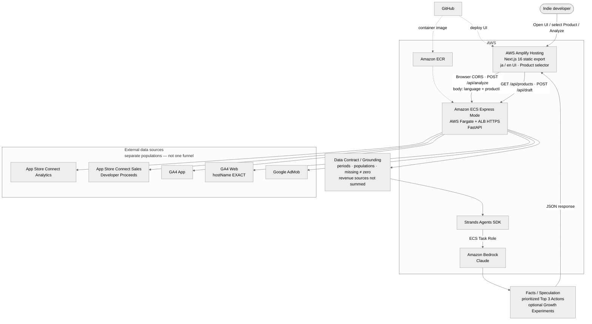
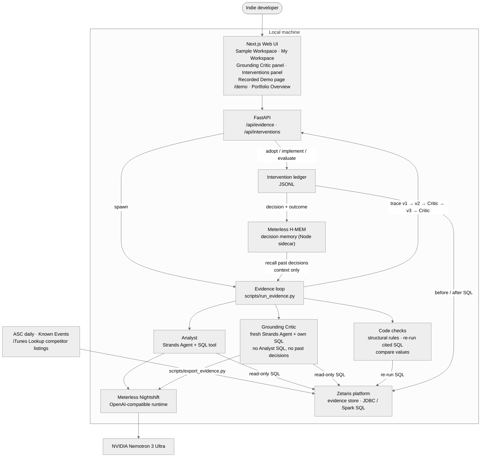

# Indie Growth Agent

[English](README.md) | [日本語](README.ja.md)

Indie app 向けの成長分析 Agent（ハッカソン MVP を **Open Agent Hackathon 2026 — Track 2「The Agent That Can Explain Why」** 向けに拡張）。

**デモ動画（英語）:** [youtu.be/yA2SuF5RMV0](https://youtu.be/yA2SuF5RMV0)

## Quick Demo（30秒で分かる）

**何ができるか。** インディーアプリの次の成長施策を AI が提案します。提案の裏にある根拠項目（evidence）の値には、その値を再現する SQL を必ず付けます。独立した **Critic** が自分で書いた SQL でその値を照合し、一致するかは **コード** が判定し、Analyst が改訂します（v1 → v2 → Critic → v3 → Critic）。主張の本文や提案の理由にだけ書かれた数字は照合しません（[照合の範囲](#照合の範囲と収束解消の意味)）。人が採用した施策は変更前後を SQL で計測し、その結果が次回の分析に渡ります。

**実際に見つけたこと。** Recorded Demo の `competitor-variant` で、v2 はページビュー→ダウンロード率を 5.0 → 6.67 と報告していました。改善したように読めます。しかし Analyst の SQL は分子と分母が逆で、その SQL を再実行しても同じ誤った数字が返ります。Critic が自分で書いた SQL で、実際の率は **20.0% から 15.0% に下がっていた** ことが分かりました。誤った数字は1位のアクションの成功基準にも入り込んでいました。v3 で両方が直り、2回目のレビューですべての値が一致しました（[詳細](#成功例critic-が見つけたものと-analyst-の直し方)）。

**なぜ価値があるか。** モデルに自己採点させません。Critic は Analyst の SQL も推論も見ず、値の一致はコードが判定し、解消できなかった指摘は隠さず「未解決」として表示します。

**再生方法（API キー・モデル呼び出し・`.env` 不要）:**

```bash
python3 -m venv .venv && source .venv/bin/activate && pip install -r requirements.txt
python scripts/show_sample_demo.py     # 全 Recorded Demo: v1/v2/v3 の Top 3、Critic の件数、レビュー注記
```

提案、Critic の指摘、その裏の SQL を見るには Web UI を使います。Recorded Demo 画面は **モデル呼び出しも API キーも不要** ですが、保存済みの実行をローカルの API サーバーから読むため、`api_server.py` を起動しておく必要があります。API はモデルの設定がなくても起動します（`scripts/verify_api_without_model.py` がプロバイダーごとに確認）。モデルの設定が必要なのは Analyze だけです。

```bash
python api_server.py                       # ターミナル 1
cd web && npm install && npm run dev       # ターミナル 2
```

1. `http://localhost:3000` を開くと **Sample Workspace**（架空データ。AI は実行しない）が開きます。ヘッダーの **Recorded Demo** をクリックすると、独立した Recorded Demo 画面 `/demo` が開きます。
2. `/demo` は表示言語にかかわらず英語版の `base` の実行を開きます。上の例を見るには **competitor-variant** に切り替えます（モデル出力は日本語で、画面にその旨が表示されます）。
3. 上から順に読みます: アプリで何が起きたか（架空データの小さなグラフ3つ）→ v1 / v2 / v3 の提案がどう変わったか → 参照している主張と既知の限界付きの最終 Top 3 → Critic が疑ったことと Analyst の回答（Critic 1回目の `r1-f3`、`r1-f7`、`r1-f13`）→ 未解決の件数を含む結果。あとで誤りと確認された指摘には **既知の誤判定** の印が付きます。
4. **SQL の根拠** と **詳細ログ**（版ごとの主張、Critic の SQL と値）は一番下に折りたたまれています。

**どこを見れば分かるか**

| 見たいもの | 見る場所 |
|------------|----------|
| ループとガード | [`evidence/loop.py`](evidence/loop.py)、[`evidence/critic.py`](evidence/critic.py)（コード側の検証）、[`evidence/agents.py`](evidence/agents.py)（独立した Critic） |
| 上の例の生データ | [`samples/recorded/sample-competitor-variant-20261024-220111.json`](samples/recorded/sample-competitor-variant-20261024-220111.json): v2 の Critic の指摘 `r1-f3`、`r1-f7`、`r1-f13` と、v3 の `findingResponses` |
| まだ検証できていないもの | 各 `samples/recorded/*.sample.json`（レビュー結果、既知の限界）と [Known limitations](#known-limitationsmvp) |
| 計測とフィードバック | [`interventions/`](interventions/)、[`memory/recall.py`](memory/recall.py) |
| スポンサー技術の連携 | [`integrations/zetaris/`](integrations/zetaris/)、[`integrations/meterless/`](integrations/meterless/)、[`integrations/hmem/`](integrations/hmem/) |

**目次:** [Track 2](#open-agent-hackathon-2026--track-2-the-agent-that-can-explain-why) · [根拠ループ](#根拠の検証改訂ループv1--v2--critic--v3--critic) · [施策管理](#施策管理変更前後の計測人の評価次回へのフィードバック) · [スポンサー技術](#スポンサー技術とその役割) · [Portfolio Overview](#portfolio-overview表示とポートフォリオ分析未実装の違い) · [サンプルデータと Recorded Demo](#架空サンプルデータlive-samplerecorded-demo) · [Architecture](#architecture) · [セットアップ](#セットアップ) · [実行方法](#実行方法) · [テスト](#テスト) · [Roadmap](#roadmap) · [Known limitations](#known-limitationsmvp)

## 概要

**接続できた Product チャネル**（App Store Connect Analytics、任意の ASC Sales、GA4 App、GA4 Web、AdMob）の観測データを集め、数字の要約ではなく **優先すべき Top 3 Actions** を返します。実行ランタイムは **Strands Agents SDK** で、モデルプロバイダーは切り替え可能です（既定は **Amazon Bedrock**、ハッカソンの実行は **Meterless Nightshift → NVIDIA Nemotron**）。**Next.js の静的 Web UI**（日本語 / English）と **Multi-Product** カタログ（`products/`）を含みます。

ハッカソンでは **根拠の検証・改訂ループ** を追加しました。Analyst が主張（claim）付きでアクションを提案し、主張の根拠項目の値にはすべて、根拠ストア（実データは **Zetaris**。[このリポジトリで確かめられる範囲](#meterless-と-zetarisこのリポジトリで確かめられる範囲)）でその値を再現する SQL を付けます。独立した **Grounding Critic** が自分で書いた SQL で主張を照合し、Analyst が改訂します（v1 → v2 → Critic → v3 → Critic）。採用したアクションは **施策（intervention）** として管理し、変更前後の数字を SQL で計測して人が評価します。その結果は **Meterless H-MEM** の判断メモリを通じて次回の Analyst に渡ります。

## Open Agent Hackathon 2026 — Track 2: The Agent That Can Explain Why

このトラックが求めるのは、何を勧めるかだけでなく **なぜそれを勧めるのか** を示せるエージェントです。本プロジェクトでの「なぜ」は次のとおりです。

- 提案した各アクションは **主張（claim）** を指し、各主張は **fact**（自アプリのデータ）、**observation**（他アプリの公開情報）、**hypothesis**（検証計画が必要）のいずれかに分類される
- fact と observation の根拠項目の値には、根拠ストアでその値を **再現する SQL** が付く（主張の本文や提案の理由にだけ書かれた数字は照合しない）
- 別の **Critic** が、自分で書いた SQL でその値を照合する。値が一致するかは **コード** が判定し、モデルには判定させない
- 改訂の履歴（v1、v2、Critic の指摘、v3、2回目のレビュー、未解決の指摘）はトレースとして保存され、Web UI に表示される
- 人が提案を実行したあと、計測した結果と人の評価が次回の分析の文脈になる

### ハッカソン期間中に作ったもの（このリポジトリの `open-agent-2026` ブランチ）

| 領域 | 追加したもの |
|------|--------------|
| 根拠ループ | 根拠スキーマ、読み取り専用 SQL ガード、SQLite / Zetaris の根拠ストア、ASC 日次データ・Known Events・競合の掲載情報からの根拠テーブル、Analyst + Grounding Critic のループ（`evidence/`） |
| モデルプロバイダー | すべての Strands Agent を `llm.build_model()` 経由に統一: `bedrock`（既定）、`openai_compatible`、`meterless`（Meterless Nightshift。NVIDIA Nemotron 3 Ultra に固定） |
| 施策管理 | AI の提案を採用、または手動で登録。実施 → 評価のライフサイクル、変更前後の SQL 計測、人の評価（`interventions/`、`scripts/interventions.py`） |
| 判断メモリ | `none` / `local`（JSONL）/ `hmem`（Meterless H-MEM の参照実装を Node の別プロセスで実行）。根拠ループの実行前に過去の判断と結果を思い出す（`memory/`、`integrations/hmem/`） |
| API | `/api/evidence`（実行の一覧・取得・開始）、`/api/interventions`（採用・登録・実施・評価・再計測・取りやめ） |
| Web UI | `/` の Sample Workspace / My Workspace、Grounding Critic の改訂履歴パネル、施策パネル、Portfolio Overview（`/portfolio`）、Recorded Demo 画面（`/demo`） |
| サンプルモード | 架空の麻雀サンプル CSV と2つのシナリオ、専用 SQLite での Live Sample、レビュー注記付きの Recorded Demo トレース3本（英語版 `base`、日本語版 `base` と `competitor-variant`） |
| テスト | `scripts/verify_offline.py` で 19 のオフラインチェックを実行（認証情報・ネットワーク・モデル不要） |

ハッカソン以前に作ったもの（Analyze、Data Grounding、Multi-Product、ASC / GA4 / AdMob 取得、Planner、Draft、AWS デプロイ）は [`docs/pre-existing-work.md`](docs/pre-existing-work.md) にまとめています。

## 解決する課題

インディー開発者は ASC・GA4・AdMob を別々に見がちで、期間・母集団が揃わないまま「なんとなく」優先度を決めやすいです。

この Agent は次をやります。

1. 選択した Product の接続ソースから直近 N 日 vs 前 N 日の事実を取得する
2. Data Grounding 用の契約（期間・母集団・欠損・推測禁止・Revenue の安易な合算禁止）を入力に埋め込む
3. 観測に基づく **Top 3 Actions** を返す（未確認の分析機能は提案しない）
4. （根拠ループ）提案の裏にある根拠項目の値すべてに再現用の SQL を求め、独立した Critic にその値を照合させ、改訂の履歴を残す

複数ダッシュボードを一つの要約にまとめることが目的ではありません。接続できた事実から、**次にどこから手を付けるべきか**を優先順位付きで提示することが価値です（対象は選択中の Product）。

## 根拠の検証・改訂ループ（v1 → v2 → Critic → v3 → Critic）

実装は `evidence/loop.py`、`evidence/critic.py`、`evidence/agents.py`。CLI（`scripts/run_evidence.py`）または Web UI（同じスクリプトを起動）から実行します。

| 段階 | 担当 | 内容 |
|------|------|------|
| v1 | Analyst | 自アプリの表（`asc_daily`、`asc_daily_by_source`、`known_events`）だけを使う。`asc_daily` の最新日を基準に、直近7日と前7日を比べる |
| v2 | Analyst | 競合の公開情報の表（`competitor_listing`）を加える。この表を根拠にした主張は fact ではなく observation |
| Critic 1回目 | コード + Critic | 下記のレビュー。指摘がなければ `converged` |
| v3 | Analyst | 各指摘に応答し（`fixed` / `downgraded` / `removed` / `disputed`）、各アクションをどう変えたか（`kept` / `modified` / `removed`）を記録する |
| Critic 2回目 | コード + Critic | v3 に同じレビュー。最終回（既定 2回、CLI の `--max-rounds` で 1〜3）でも残った指摘は `unresolved` になり、実行は `max_rounds` で終わる |

**Critic の各回でやること**

1. **構造のルール（コード）**: 根拠があるか、引用した表が存在するか、根拠1項目に数字1つか、fact に SQL があるか、他アプリの公開情報を fact にしていないか、hypothesis に検証計画があるか、競合の observation だけを根拠にしたアクションでないか
2. **Analyst が引用した SQL の再実行（コード）**: 結果が、書かれた精度で記載値と一致すること。単位は換算しない（下記）
3. **独立した Critic（モデル）**: 会話を共有しない新しい Strands Agent。主張とアクションは見るが、**Analyst の SQL と推論は見ない**。過去の判断も受け取らない。自分で SQL を書いて照合し、`causal_leap`、`scope_mismatch`、`kind_mislabel`、`unverifiable`、`infeasible_action`（アクションや検証計画が App Store の機能制約に反する）を指摘できる
4. **値の照合（コード）**: Critic の SQL の結果を、そのチェックが指定した根拠項目（`evidence_index`）の値とコードで比べ、食い違えば `value_mismatch` の指摘になる。指定した項目ではなく別の項目の値を返したチェックは、一致ではなく照合不能として数える。`evidence_index` のないチェックだけは、その主張のすべての根拠項目と比べる。同じ主張の中の2件の不一致は、2件の指摘として残る

#### 照合の範囲と、収束・解消の意味

- **照合するもの**: SQL と単一の値を持つ根拠項目の値（コードが SQL を再実行）と、Critic の各チェック（対応する根拠項目と比較）
- **照合しないもの**: 主張の本文・提案の理由・検証計画にだけ書かれた数字、複数の数値をまとめた値、1つの値を返さない SQL のチェック（照合不能として表示）。チェックは Critic が自分で選ぶので、すべての根拠項目にチェックが付くとは限らない
- **単位**: 件数・評価・金額は100倍・0.01倍で一致させず、0 と非0 も一致させない。率だけは単位が分かる場合に限り比率と百分率を換算する: 記載値が `%` 付きで SQL が比率（割り算）を返す場合と、SQL が百分率（割り算に100を掛けたもの）を返す場合
- **`converged`（収束）**: 最後のレビューで指摘が0件だったこと。すべての数字が検証済みという意味ではない。照合不能のチェックや、根拠項目の外にある数字は残りうる
- **`resolved`（解消）**: 次のレビューで、同じ主張に同じ種類の指摘が出なかったこと。主張が書き換えられた場合や取り下げられた場合も含むので、修正が正しいことの証明ではない。`downgraded`（格下げ）は主張が仮説になったこと。`unresolved`（未解決）は最終回でも残ったこと（検証されていないという意味で、誤りと証明されたわけではない）

これらの規則は Recorded Demo の記録後に厳しくしました。Recorded Demo の結果は記録時のまま表示しています。保存済みの値を現在の規則で比べ直したときの違いは、[表の下の注記](#架空サンプルデータlive-samplerecorded-demo)にあります。

**レビュー前のガード**

- 両モデルの SQL はすべて読み取り専用ガードを通る（単一の `SELECT` / `WITH` のみ、書き込み系キーワード禁止）。SQLite では読み取り専用の authorizer も使う
- v1 / v2 の回答が、その回答の中で成功した SQL なしに数値の fact を述べた場合は却下して1回だけやり直す。2回目も却下されたら実行を止めるので、作られた数字が Critic に届くことはない
- 理由を書かずにすべてのアクションを消した改訂も同じ扱いで却下する

トレース（`tmp/evidence_runs/<run_id>.json`）は各段階のあとに書き直され、各版、すべての SQL 呼び出し（Analyst / Critic / コード）、Critic の指摘とその解消状況（`resolved` / `downgraded` / `unresolved`）、却下された回答、所要時間、モデル名を含みます。

**範囲:** 根拠ループが使うのは現在、App Store Connect の日次データ、Known Events、競合の公開掲載情報（iTunes Lookup）です。GA4 と AdMob は Live Analyze の経路だけで使います。根拠ループと Live Analyze は別の実行で、ループは Live Analyze の Top 3 を読みません。

## 施策管理・変更前後の計測・人の評価・次回へのフィードバック

実装は `interventions/`、`interventions_api.py`、`scripts/interventions.py`、Web UI の施策パネル。

```
AI の提案を採用 / 手動で登録 → planned
  → 実施日を記録（implement）→ 変更前の期間を SQL で計測
  → 評価を記録（evaluate）  → 変更後の期間を SQL で計測 + 人の判定
  → 判断と結果を判断メモリへコピー
  → 次回の根拠ループ: Analyst に「過去の判断」として渡す
```

- **採用または登録**: 完了した実データの実行から1つのアクション（1〜3位）を採用するか、人が考えた変更を登録する。採用したアクションは AI の提案（主張、検証計画、モデル、版）をそのまま保存し、書き換えない。架空サンプルデータの実行は採用できない
- **計画**: 評価指標、判定方法、成功基準、評価までの日数、計測期間の長さ。指標は `impressions`、`product_page_views`、`first_time_downloads`、`impression_to_page_view_pct`、`page_view_to_download_pct`
- **変更前 / 変更後**: 根拠ストアの `asc_daily` に対する SQL でコードが計算する（実施日の前の期間 / 後の期間）。期間内のすべての日に行がある場合だけ計測し、欠けた日がある期間は少ない日数で合計せず「スキップ」と記録する。数字を手入力することはない
- **人の評価**: `improved` / `no_change` / `worse` / `inconclusive` とメモ。評価日より前に評価するには「早期評価」の指定が必要
- **次回の Analyst へのフィードバック**: 判断は人が採用・登録したときに、結果は評価したときにメモリへ書く。分析の実行がメモリに書くことはない。実データの根拠ループの前に、この Product のメモリを検索し、見つかった判断を台帳から読み直し（取りやめたものは除く）、Analyst に **根拠ではなく文脈として** 渡す。数字が必要なら Analyst はストアに問い合わせ直す必要がある。Critic には渡さない
- **保存先**: 台帳（`INTERVENTIONS_PATH`、既定 `tmp/interventions/ledger.jsonl`）が記録の本体で、`MEMORY_BACKEND` に関係なく残る。メモリは読みやすい写しを持つ（あとから `sync-memory` で結び直せる）

## スポンサー技術とその役割

| 技術 | このプロジェクトでの役割 | 場所 |
|------|--------------------------|------|
| **Zetaris** | `EVIDENCE_STORE=zetaris` のときの実データの根拠ストア。根拠テーブルを CSV としてローカルの Zetaris platform に置き、Lightning filestore テーブルとして登録する。その場合、Analyst の SQL、Critic の SQL、コードによる再実行、施策の変更前後の計測は、すべて JDBC（Spark SQL）経由でここで実行する | `integrations/zetaris/` |
| **Meterless Nightshift** | ローカルの OpenAI 互換モデルランタイム（`LLM_PROVIDER=meterless`）。すべての Strands Agent（Analyst、Critic、Analyzer、Planner、Draft）がここへリクエストを送る。リクエストにはこのアプリを示す `meterless-app` ヘッダーを付ける。Analyst / Critic のリクエストが再試行で直る理由で失敗した場合は1回だけやり直し、プロバイダーのエラーは詳細付きでログに残す | `integrations/meterless/`、`llm/` |
| **NVIDIA Nemotron** | ハッカソンの実行で Analyst と Critic を動かすモデル: `nvidia/nemotron-3-ultra-550b-a55b`。Nightshift の NVIDIA プロバイダー経由で呼ぶ（このマシンでは `meterless/auto` が 404 を返すモデルに振り分けられたため固定） | `METERLESS_MODEL` |
| **Meterless H-MEM** | 判断メモリのバックエンド（`MEMORY_BACKEND=hmem`）。公式の参照実装を同梱し、Node.js の別プロセスで動かす。判断と結果を Product ごとに保存し、根拠ループの前に思い出す | `integrations/hmem/` |
| Strands Agents SDK | 構造化出力と SQL ツールを含む、すべてのモデル呼び出しの Agent ランタイム | `agent.py`、`evidence/agents.py` |
| Amazon Bedrock | 既定のモデルプロバイダー（`LLM_PROVIDER` 未設定または `bedrock`）で、過去の AWS デプロイで使ったプロバイダー | `llm/factory.py` |

Live Sample と Recorded Demo は Zetaris ではなく専用の SQLite ファイルを使うので、架空データが実データの根拠ストアに入ることはありません。

### Meterless と Zetaris：このリポジトリで確かめられる範囲

| | Meterless Nightshift | Zetaris |
|-|----------------------|---------|
| コードの経路 | `LLM_PROVIDER=meterless` → `llm/factory.py`、`integrations/meterless/` | `EVIDENCE_STORE=zetaris` → `evidence/factory.py`、`integrations/zetaris/` |
| オフラインテスト（`verify_offline.py` に含む） | `verify_meterless.py`: プロバイダーの設定、状態確認、モデルのエラー処理を、Nightshift ではなくローカルの偽サーバーで確認 | `verify_zetaris_store.py`: CSV の配置、テーブル登録、テーブル名の修飾、読み取り専用ガードを、Zetaris ではなく偽エンジンで確認 |
| 実接続の確認（オフライン一式には含まない） | `check_meterless.py`（`--chat` は1回リクエストを送る） | `verify_zetaris_live.py`（ローカルの Zetaris platform、Java 17 以上、JDBC jar が必要） |
| コミット済みの実行結果 | `LLM_PROVIDER=meterless` で記録したものはない。Recorded Demo の3本のトレースはモデルを `openai_compatible:nvidia/nemotron-3-ultra-550b-a55b` と記録している。トレースには接続先 URL が残らないため、Nightshift の OpenAI 互換エンドポイント経由だったことは開発者の説明であり、ファイルからは確かめられない | `verify_zetaris_live.py` を1回実行した出力（接続、確認用テーブルの書き込みと読み戻し、テーブル定義。データの行は含まない）を [`docs/zetaris-live-check.md`](docs/zetaris-live-check.md) に残している。Recorded Demo は SQLite を使う。実アプリのデータでの Zetaris 上の根拠ループはローカルで実行したが、そのトレースは実データを含むためコミットしておらず、リポジトリからは結果を確かめられない |

つまりこのリポジトリが示すのは、各連携の組み込み方と偽の相手に対するテスト、それに記録した Zetaris の接続確認1回までで、どちらについても実接続での根拠ループの成功は示していません。

## Multi-Product

分析は常に **1 Product 単位**です（カタログ: `products/index.json` + 各製品 JSON）。

- **CLI**: `python agent.py --product-id <id>`（省略時は `products/index.json` の default）
- **API**: `GET /api/products` が一覧を返し、`POST /api/analyze` は `{ language, productId }` を受け取る
- **Web UI**: Header の Product セレクタ。切替時はその Product の **前回成功した Analyze** を localStorage から復元（なければ空シェル）

### Portfolio Overview（表示）とポートフォリオ分析（未実装）の違い

- **Portfolio Overview（`/portfolio`、実装済み）**: 設定済みのアプリごとに1枚のカードを表示する。中身は、そのアプリについて **このブラウザに保存された最後の成功した Live Analyze**（期間、最優先の推奨、ソースごとの主要指標2つ、実行 ID）、または「未分析」。localStorage を読むだけで、分析のための API 呼び出し、値の生成、推奨の作成は **しない**
- **アプリ横断のポートフォリオ分析（未実装）**: アプリ同士を比べて、開発者の時間を次にどのアプリへ使うべきかを決めること。各カードは別々の 1 Product の結果のままで、カード間の数字を比較・順位付けはしない

## Data Grounding

プロンプトと入力テキストに次を固定しています。

| 原則 | 内容 |
|------|------|
| Reporting period alignment | ASC の `latest_processing_date` を基準に、GA4 / AdMob も同じ直近 N 日・前 N 日を使う |
| Population scope | ASC Analytics（ストア / テリトリー）、GA4 App（原則プロパティ全体）、GA4 Web（設定時は `hostName` EXACT）、AdMob（設定した App ID）、ASC Sales Revenue（Trends・原則 WW）は **別母集団** |
| Missing data ≠ zero | 未接続ソースや、行のない期間・日を「ゼロ実績が証明された」とはみなさない（入力に明記）。接続済みソース内の個別メトリクス欠落を missing と zero に分類済み、という意味ではない |
| Facts / Speculation separation | 観測可能な数値のみ Facts。推論は Speculation 枠に分離 |
| No ungrounded cross-source ratios | 母集団一致の記述がない限り、ソース間の割り算・ファネル化をしない（例: GA4 `ad_impression` ≠ AdMob `IMPRESSIONS`） |
| Revenue sources stay separate | AdMob **ESTIMATED_EARNINGS** と App Store Sales **Developer Proceeds** は意味・確度・通貨/スコープが異なる別ソース。並列表示し、**合算しない** |

Live Analyze の経路では、LLM 出力はプロンプト / Data Contract で制約していますが、生成後の機械検証はしていません（Known limitations 参照）。根拠ループは、自身の提案に対して機械的な検証（SQL の再実行、構造のルール、Critic）を加えています。根拠テーブルは母集団の列（`territory`、`country`、`source`）を持ち、欠損値は 0 で埋めず NULL のまま保持します。

## 対応ソース（現在）

| ソース | 状態 | 主な用途 |
|--------|------|----------|
| App Store Connect Analytics | 必須（App Store チャネル有効時） | インプレッション、PV、初回 DL、ソース内訳、転換率、前週比 |
| App Store Connect Sales（Trends） | 任意 | Units × **Developer Proceeds**（推定。Financial Partner Share ではない）、前週比。原則 WW で、ASC Analytics のテリトリーと同一視しない |
| Google Analytics 4 **App** | 任意 | activeUsers / sessions / screenPageViews、設定した **App** key events、前週比（製品設定でフィルタしない限りプロパティ全体） |
| Google Analytics 4 **Web** | 任意 | 設定ホストの activeUsers / sessions / page views（`hostName` EXACT）、任意の **Web** key events / `featurePaths` / ページパス、前週比 |
| Google AdMob Network Report | 任意 | ESTIMATED_EARNINGS / IMPRESSIONS / IMPRESSION_RPM (eCPM) / CLICKS、前週比 |

未設定のソースは `not connected` として扱い、値を捏造しません。

Revenue UI では AdMob 推定収益と App Store Developer Proceeds を **別行** で表示します（意味・確度が異なるため合算しません）。

### 根拠テーブル（根拠ループ）

`scripts/export_evidence.py` が `EVIDENCE_STORE` に読み込みます。

| テーブル | 取得元 | 種類 |
|----------|--------|------|
| `asc_daily` | App Store Connect Analytics の日次合計（ASC の認証情報が必要） | 自アプリのデータ → fact |
| `asc_daily_by_source` | ASC の日次インプレッション / 初回ダウンロードの search / browse / referrer 別 | 自アプリのデータ → fact |
| `known_events` | 開発者が書いた文脈（`known_events.json`） | 文脈のみ。時期が近くても原因の証明にはならない |
| `competitor_listing` | 自アプリと、製品 JSON の固定の競合リスト（`competitors`）の App Store 公開掲載情報（iTunes Lookup、キー不要） | 外部 → observation |

## 架空サンプルデータ・Live Sample・Recorded Demo

デモ用に、**架空の** 麻雀サンプルを `samples/mahjong/` に置いています（`sample_mode.py`）。中の数字・アプリ・掲載情報はすべて作り物です（`source = fictional_sample`、アプリ ID `fictional-001`）。設定済みの実在アプリの ID を含むデータは読み込みを拒否します。

| シナリオ | 内容 |
|----------|------|
| `base` | 14日間（2026-10-09〜2026-10-22）。直近7日は表示回数が40%増えたが、ページビュー率と初回ダウンロードは下がった。経路別では browse の表示回数が最も増えた。上位の競合は評価数・スクリーンショット数・更新の新しさで上回る |
| `competitor-variant` | `base` と同じだが、競合1件（`fictional-101`）だけその3つの優位をなくしたもの。変えたセルはすべて、元の値・新しい値・理由とともに `scenarios.json` に書いてある |

使い方は3つで、互いに混ざりません。

| モード | モデル呼び出し | ストア | 方法 |
|--------|----------------|--------|------|
| **架空 CSV のみ** | なし | `tmp/sample/<scenario>.sqlite` | `python scripts/run_sample.py --scenario base --dry-run` で CSV（とシナリオの変更）を読み込み、期間と行数を表示して止まる |
| **Live Sample** | あり（`LLM_PROVIDER`） | 専用 SQLite。`EVIDENCE_STORE` は無視 | `python scripts/run_sample.py --scenario base` で本物の Analyst と Critic を動かす。過去の判断は思い出さない。トレース: `tmp/evidence_runs/sample-<scenario>-<timestamp>.json` + `.sample.json` |
| **Recorded Demo** | なし（API キー・ネットワーク・モデル不要） | コミット済みのトレース | `samples/recorded/` のトレース。Live Sample の実行を、チェック（sample の実行 ID、CSV が変わっていない、完了している、モデル名がある、Critic のレビューが1回以上ある）を通った場合だけ `scripts/record_sample_demo.py` でコピーしたもの |

### 成功例：Critic が見つけたものと Analyst の直し方

`sample-competitor-variant-20261024-220111` より（v2 → Critic 1回目 → v3 → Critic 2回目）。架空データ: 前7日はインプレッション 30,000 / ページビュー 1,800 / ダウンロード 360、直近7日は 42,000 / 2,100 / 315。

| | v2（Analyst） | Critic 1回目 | v3（Analyst） | Critic 2回目 |
|-|---------------|--------------|---------------|--------------|
| 主張 C1（前7日） | インプレッション→ページビュー率 **16.67**、ページビュー→ダウンロード率 **5.0** | Critic の SQL `SUM(product_page_views) * 100.0 / SUM(impressions)` は **6.0** を返し、コードが `value_mismatch` を記録（記載値 16.67）。ダウンロード率も同様（**20.0** vs 5.0） | **6.0%** と **20.0%** | 一致 |
| 主張 C2（直近7日） | **20.0** と **6.67** | Critic の SQL は **5.0** と **15.0** を返し、`value_mismatch` | **5.0%** と **15.0%** | 一致 |
| 1位のアクションの成功基準（主張 C14） | 「ページビュー→ダウンロード率が **6.67 から 5.0 以下** に改善」（逆転した数字に基づく、方向が逆の目標） | Critic: 成功基準が誤った値を使っており、「改善」なのに数字を下げる方向になっている（`scope_mismatch`） | 「**15.0% から 20.0% 以上** に改善」 | 指摘なし |

独立した照合が必要だった理由: v2 の SQL は `SUM(impressions) * 1.0 / SUM(product_page_views)`（と `SUM(product_page_views) * 1.0 / SUM(first_time_downloads)`）だったため、**Analyst 自身の SQL を再実行すると 16.67 と 5.0 が再現される** 状態でした。数字は SQL と食い違っていないものの、ラベルとは逆の意味でした。Analyst の SQL を見ない Critic が率を定義どおりに書き、コードが値を比べたことで見つかりました。Critic は指摘の中で、正しい前7日の率は 6.0%（1,800 / 30,000）と 20.0%（360 / 1,800）だと逆転の中身も説明しています。v3 で Analyst はこれらの指摘すべてに `fixed` と応答し、2回目のレビューで C1 / C2 の10個の値がすべて一致しました。これらの指摘は `resolved` です。

同じ回で、v3 は PPO に search 経由だけのコンバージョン率を求めていた検証計画も直しました（PPO はトラフィックソース別に結果を分けないため。`resolved`）。すべてが直ったわけではありません。C5・C6・C12 の因果の飛躍の指摘は、応答はあったものの2回目でも再び指摘され、未解決のままです（下の表）。

**コミット済みの Recorded Demo**（結果は実行ごとに異なります。日本語版の2本は、すべての指摘が解消済みではありません）:

| 実行 | モデル出力 | トレース上のモデル名 | 結果 | 所要時間 |
|------|-----------|----------------------|------|----------|
| `sample-base-20261025-110333`（代表の `base`） | 英語 | `openai_compatible:nvidia/nemotron-3-ultra-550b-a55b` | `converged`、未解決の指摘0件。最終 Critic の SQL 照合は一致31・不一致0・照合不能1。v3 の提案 #1・#3 に既知の限界2件 | 約9.5分 |
| `sample-base-20261024-214121` | 日本語 | `openai_compatible:nvidia/nemotron-3-ultra-550b-a55b` | `max_rounds`、v3 に未解決の指摘1件 | 約15分 |
| `sample-competitor-variant-20261024-220111` | 日本語 | `openai_compatible:nvidia/nemotron-3-ultra-550b-a55b` | `max_rounds`、v3 に未解決の指摘8件（うち2件は既知の誤判定） | 約24分 |

トレースにはモデルが `openai_compatible` とモデル ID で記録されています。開発者の説明では接続先は Nightshift の OpenAI 互換エンドポイントですが、トレースには接続先 URL は残っていません。各 `.sample.json` には、レビュー結果と既知の限界（日本語と英語）が入っており、日本語版の2本には比較上の注意もあります。英語版の `base` には `"representative": true` が付いており、`/demo` と Sample Workspace は表示言語にかかわらずこれを表示します。日本語版の `base` もコミットしたまま残しており、CLI ビューアと API から見られます。収束した実行が1本あることは、実行が一般に収束することを示しません。2つのシナリオの違いを、競合データの変更による因果効果として **読まないでください**。各シナリオ1回ずつの実行ではモデルのばらつきとデータの違いを切り分けられず、実行条件も同一ではありません。

**記録時の結果と現在の照合規則。** 表の件数は記録時のコードが判定したもので、そのコードは件数にも100倍・0.01倍の一致を許し、Critic が指定した `evidence_index` を使っていませんでした。保存済みの値を現在の規則で比べ直すと（モデルは再実行していない）、変わるのは `competitor-variant` の最終 Critic だけです。C16 のチェック（無料の競合の数 5 と、各アプリの価格 0.0）が不一致になり、照合は一致41・不一致2 から一致40・不一致3 になります。C8 のチェック（評価平均 4.1）は評価件数 410 の根拠項目と組み合わされていましたが、現在の規則では 4.1 の根拠項目と一致します。また Critic 1回目では、C1 と C2 にそれぞれ2件の不一致チェックがありましたが、修正前の重複除去で指摘は各1件しか記録されていません。base の2本の件数は変わりません。Critic が指定した `evidence_index` は保存されていないため、各一致が指定どおりの項目とのものだったかは確かめられません。トレースは書き換えておらず、これらの注記は各 `.sample.json` の既知の限界にあります。

**Recorded Demo の再生方法**

```bash
# CLI: 記録済みの全実行と、base と competitor-variant の比較
python scripts/show_sample_demo.py
python scripts/show_sample_demo.py --run-id sample-base-20261024-214121
```

Web UI では、架空データと実データを同じ画面に混ぜません。

- **Sample Workspace（`/`、最初に開く）**: 架空のサンプルだけ。ビルド時に `samples/` から作り、API もモデルも呼ばない。直近7日と前の7日の KPI、Known Events 付きの14日間の推移、流入経路別の表、代表の Recorded Demo の最終 Top 3（各アクションの下に参照している主張と既知の限界）、その Critic の照合件数
- **My Workspace（`/`、上部で切り替え）**: 選択中の Product の実際の分析結果（Live Analyze、Grounding Critic パネルの根拠ループの実行、施策管理）。選択は `localStorage` に保存する
- **Recorded Demo（`/demo`）**: コミット済みの Recorded Demo だけを表示する独立画面

`/demo` の閲覧にモデル呼び出しも API キーも不要ですが、画面は `/api/evidence` から実行を読むため、`python api_server.py`（と `npm run dev`）を起動しておく必要があります。この画面は次のとおりです。

- 表示言語にかかわらず代表の英語版 `base` を開き、`base` と `competitor-variant` を切り替えられる。モデル出力の言語が表示言語と違う場合は、切り替えボタンと画面にその旨を表示する。モデル出力は翻訳せず、UI のラベルとレビュー注記は表示言語に従う。英語 UI では、サンプル由来の日本語の用語の直後に、区別できる形で訳（`[translation: …]`）を補う
- 架空データの保存済み Recorded Demo で、実モデルで実行したものだと明示する
- 冒頭の **アプリで何が起きたか** で、架空データのグラフを3つ示す（初回ダウンロード、Browse 経由の表示回数、Browse 経由の初回ダウンロード。前の7日と直近7日、グラフごとに0から始まる目盛り）。実行の `.sample.json` のハッシュと期間が、画面のビルドに使った CSV と一致する場合だけ表示する
- v1 / v2 / v3 の Top 3 のタイトルを並べて比較し（v1 — 自アプリのデータ、v2 — 競合の状況、v3 — Critic レビュー済みの提案）、変更理由も示す。その下に **最終 Top 3 アクション — v3** を全幅で表示し、各アクションの理由、参照している主張、既知の限界を並べる
- 各回で Critic が疑ったことを一覧にする: 指摘、記録された解消状況、コードが判定した SQL 照合（一致・不一致・照合不能）、次の版での Analyst の回答
- Recorded Demo の既知の限界がその指摘の ID と種類を挙げている場合、指摘に **既知の誤判定（実行後のレビューで確認）** の印を付け、種類を「記録された分類」と表示する（`competitor-variant`: `r2-f1`・`r2-f2`）。トレース、Critic の本文、未解決の件数は変えずに表示する
- 結果（レビューの状態、未解決の件数、照合不能の件数、既知の限界）を示す
- **SQL の根拠**（最終版の各主張とその SQL）と **詳細ログ**（版ごとの主張、Critic の照合 SQL と値、比較上の注意）は折りたたんで表示する

My Workspace の Grounding Critic パネルには実データの実行だけを表示します。Recorded Demo と Live Sample の実行（同じ product id）は含めません。

## ディレクトリ構成

```
indie-growth-agent/
├── agent.py                 # 共有分析エントリ（取得 → 入力整形 → モデル）
├── api_server.py            # FastAPI: /api/products, /api/analyze, /api/draft（+ evidence / interventions ルーター）
├── evidence_api.py          # /api/evidence: 根拠ループの実行の一覧・取得・開始
├── interventions_api.py     # /api/interventions: 採用・登録・実施・評価・再計測・取りやめ
├── analysis_schema.py       # Agent / API の構造化レスポンスモデル
├── report_builder.py        # 観測 metrics + 分析結果 → UI 用 JSON
├── format_input.py          # Data Contract / FACTS テキスト生成
├── product_config.py        # Multi-Product カタログ読込
├── planner.py               # 任意の成長実験 Planner（MCP / playbooks）
├── draft_generator.py       # Action Draft 生成
├── known_events.py          # Planner 向け Known Events
├── sample_mode.py           # 架空サンプルデータ、シナリオ、Recorded Demo のルール
├── config.py                # .env / プロセス環境変数（秘密情報はハードコードしない）
├── event_definitions.json   # GA4 App イベントの開発者宣言定義（例）
├── event_definitions_web.json
├── known_events.json
├── products/                # Product カタログ
│   ├── index.json
│   ├── mahjong.json
│   ├── shopping-memo.json
│   └── nextuta.json
├── evidence/                # 根拠スキーマ、ストア、SQL ガード、Analyst / Critic、改訂ループ
├── interventions/           # 台帳、ライフサイクル、SQL 計測、メモリ連携
├── memory/                  # 判断メモリのインターフェース（none / local）と想起
├── llm/                     # モデルプロバイダーの選択とエラー処理
├── integrations/
│   ├── zetaris/             # Zetaris 根拠ストア（JDBC、CSV の配置）
│   ├── meterless/           # Meterless Nightshift の設定とランタイム状態確認
│   └── hmem/                # Meterless H-MEM アダプター + 同梱の参照実装（Node の別プロセス）
├── samples/
│   ├── mahjong/             # 架空サンプル CSV + scenarios.json
│   └── recorded/            # コミット済み Recorded Demo トレース + .sample.json 注記
├── requirements.txt
├── Dockerfile               # バックエンド用コンテナイメージ
├── .dockerignore
├── .env.example
├── asc/                     # App Store Connect Analytics + Sales
│   └── sales.py
├── ga4/                     # GA4 App + GA4 Web Data API 取得
├── admob/                   # AdMob Network Report 取得
├── web/                     # Next.js 16 静的エクスポート Web UI
├── scripts/                 # 実行・記録・表示、接続確認、オフライン検証
│   ├── run_evidence.py      # 実データでの根拠ループ
│   ├── export_evidence.py   # 根拠テーブルを EVIDENCE_STORE へ読み込む
│   ├── interventions.py     # 施策管理 CLI
│   ├── run_sample.py        # Live Sample（または --dry-run）
│   ├── record_sample_demo.py
│   ├── show_sample_demo.py  # Recorded Demo ビューア
│   ├── check_meterless.py   # Nightshift の状態確認
│   ├── verify_offline.py    # オフラインチェック一式
│   ├── verify_ga4.py
│   ├── verify_admob.py
│   ├── oauth_admob.py
│   └── list_ga4_events.py
├── docs/                    # アーキテクチャ、ハッカソン以前の作業
└── secrets/                 # ローカル専用（gitignored）。.p8 / refresh token など
```

## Architecture

詳細な Architecture Diagram（Mermaid）とリクエストフローは **[docs/architecture.md](docs/architecture.md)** を参照してください。

### Live Analyze（過去の AWS デプロイ。現在は稼働していない）

Agents for Humans Hackathon（2026年9月）で Live Analyze をデプロイしたときの構成です。この AWS 環境は2026年10月に廃止しており、**現在公開中の環境はありません**。この README の内容はすべてローカルで動かします（[実行方法](#実行方法) 参照）。



**Connected sources → grounded analysis → 1 priority list.** 秘密情報はバックエンドのプロセス環境変数に留めます。Analyze でブラウザが送るのは `{ language, productId }` のみです（API キーは送りません）。任意の Draft は `/api/draft` に実験コンテキストとスクショを送ります。

Mermaid 単体ファイル: [`docs/architecture.mmd`](docs/architecture.mmd)

### 根拠ループと施策管理（ハッカソン、ローカル）



Live Sample は同じループを Zetaris ではなく `tmp/sample/<scenario>.sqlite` で動かし、メモリからの想起はしません。Recorded Demo はモデルを使わず `samples/recorded/` から読みます。

## Web UI の挙動（現在）

- **初期表示**: 選択 Product の前回成功した Live Analyze（`localStorage`）。なければ空シェルと Analyze 案内
- **最新データを分析**: `POST /api/analyze` で更新し、UI とキャッシュを書き換える
- **Loading / empty / error**: Analyze 中の経過秒、初回成功前の空状態、失敗時の再試行
- **i18n / a11y**: 日本語 / English の UI クロム、focus-visible やラベルの i18n など
- **言語切替**: UI クロムは即切替し、ページをまたいで保持する。**Analyze は再実行せず**、既存の Actions / Facts / Experiments 本文も書き換えない。本文の言語を変えるには、言語を選んだうえで再度 Analyze する
- **`/`: Sample Workspace / My Workspace**: 最初は Sample Workspace（架空データ、読み取り専用、AI は実行しない）を開く。My Workspace は選択中の Product の実際の分析結果。2つは混ぜず、選択は次回も保持する。ヘッダーから Portfolio と Recorded Demo へ移動できる
- **Recorded Demo（`/demo`）**: コミット済みの Recorded Demo（代表の英語版 `base` / `competitor-variant`）の独立画面。[架空サンプルデータ・Live Sample・Recorded Demo](#架空サンプルデータlive-samplerecorded-demo) 参照。モデル呼び出しも API キーも不要、ローカルの `api_server.py` が必要
- **Grounding Critic パネル**（My Workspace の Top 3 の下）: 実行の選択（実データの実行のみ）、「新しく検証を実行」（確認あり。API から起動できる実行は同時に1つ）、v1 / v2 / v3 の各段階、根拠と SQL 付きの主張、コードが判定した SQL 照合（一致・不一致・照合不能）、モデル生成と明示した Critic のコメント、解消状況付きの Critic の指摘、完了した実データの実行ではアクションごとの採用ボタン
- **施策パネル**: 一覧、手動登録、実施日の記録、評価の記録、再計測、取りやめ。AI の予測、変更前後の数字、スキップした期間、人の評価を表示する
- **Portfolio Overview**（`/portfolio`、Header のリンク）: 保存済みの Live Analyze から、アプリごとに1枚のカード（Multi-Product 参照）

詳細: [`web/README.md`](web/README.md)

## Deployment（過去の AWS 構成。廃止済み）

**現在公開中の環境はありません。** 以下は Agents for Humans Hackathon（2026年9月）で使った構成で、2026年10月に廃止しました。Dockerfile とこの説明は、記録と再デプロイのためにリポジトリに残しています。当時の環境の URL は維持していません。試すときはローカルで動かしてください（[Quick Demo](#quick-demo30秒で分かる) と [実行方法](#実行方法) 参照）。

| 層 | 採用（当時） |
|----|--------------|
| Frontend | Next.js 16 **static export** → **AWS Amplify Hosting** |
| Backend | FastAPI コンテナ → **Amazon ECS Express Mode**（AWS Fargate） |
| Image | **Amazon ECR** |
| 公開 API URL | ECS Express Mode が提供する HTTPS endpoint |
| 実行時設定 | プロセスの **環境変数**（`config.py` / `.env`）。ECS では **AWS Secrets Manager** からタスク環境変数へ **注入**しうる（Task Execution Role）。アプリ自身が Secrets Manager API を呼ぶ実装ではない |
| Bedrock | **ECS Task Role**（アプリに長期 AWS アクセスキーを置かない） |
| ECR pull（起動時） | **ECS Task Execution Role** |

再デプロイする場合: Frontend のビルド環境変数 `NEXT_PUBLIC_AGENT_API_URL=<ECS の HTTPS URL>` を設定し、Backend の `CORS_ALLOWED_ORIGINS` に Amplify オリジンを設定します（localhost 既定値はローカル用に残しています）。

使わない構成: App Runner、Amplify SSR、Next.js API Route プロキシ。

ハッカソンで追加したもの（根拠ループ、Zetaris、Meterless Nightshift、H-MEM）は **ローカル** で動かし、AWS にデプロイしたことはありません。Dockerfile はこれらに合わせて更新していません（イメージに Java / Node がなく、Nightshift / Zetaris は開発者のマシンで動く）。

## セットアップ

### 1. Python 環境

Python 3.11+ を推奨します。

```bash
python3 -m venv .venv
source .venv/bin/activate
pip install -r requirements.txt
```

### 2. 設定ファイル

```bash
cp .env.example .env
```

`.env` に実値を書き、秘密情報は `secrets/` に置きます（どちらも git 管理外）。チャネル ID は Multi-Product では `products/` 側を優先します。

最低限必要なもの:

- **App Store Connect**: Issuer ID / Key ID、対象アプリ / テリトリー（多くは Product JSON）。ローカルは `APP_STORE_CONNECT_PRIVATE_KEY_PATH`（`.p8`）、コンテナは `APP_STORE_CONNECT_PRIVATE_KEY`（PEM 本文。タスク環境変数 / Secrets Manager 注入でも可）
- **モデルプロバイダー**: `LLM_PROVIDER` 未設定 / `bedrock` なら Amazon Bedrock（ローカルでは Bedrock を呼べる認証。例: `AWS_REGION` とプロファイル。ECS に再デプロイする場合は **Task Role** を使い、アクセスキーをリポジトリに置かない）。`.env.example` はハッカソン構成として `LLM_PROVIDER=meterless` を設定している（下記「モデルプロバイダーの切り替え」参照）
- **GA4 App / Web（任意）**: Property ID + OAuth（`GOOGLE_OAUTH_*` と refresh token）またはサービスアカウント。Web の hostname / key events / featurePaths は製品 JSON
- **AdMob（任意）**: Account ID + 別スコープの refresh token（`scripts/oauth_admob.py`）+ 必要なら App ID

詳細なキー名は `.env.example` を参照してください。Web UI は `web/.env.local` の `NEXT_PUBLIC_AGENT_API_URL` を設定します（`web/README.md` 参照）。

### 3. ハッカソン構成（任意。各部分は未設定ならローカルの既定値で動く）

| 変数 | 既定値 | 用途 |
|------|--------|------|
| `LLM_PROVIDER` | `bedrock` | `bedrock` / `openai_compatible` / `meterless` |
| `METERLESS_BASE_URL` | `http://127.0.0.1:8088/v1` | Nightshift ランタイム（どの形で貼っても `<host>/v1` に正規化） |
| `METERLESS_RUNTIME_TOKEN` | なし（`meterless` では必須） | Nightshift が `<stateDir>/proxy-token` に書くトークン（`rt-local` は拒否） |
| `METERLESS_MODEL` | `nvidia/nemotron-3-ultra-550b-a55b` | Nightshift に送るモデル ID |
| `METERLESS_APP` / `METERLESS_TIMEOUT_SECONDS` / `METERLESS_TTFB_MS` | `indie-growth-agent` / `600` / `240000` | アプリ ID ヘッダー、タイムアウト、最初のトークンまでの待ち時間 |
| `OPENAI_COMPATIBLE_BASE_URL` / `_API_KEY` / `_MODEL` / `_HEADERS` / `_TIMEOUT_SECONDS` | なし | `LLM_PROVIDER=openai_compatible` 用 |
| `EVIDENCE_STORE` | `sqlite` | `sqlite` / `zetaris` |
| `EVIDENCE_SQLITE_PATH` | `tmp/evidence.sqlite` | SQLite の根拠ストア |
| `ZETARIS_USER` / `ZETARIS_PASSWORD` | なし | Zetaris のログイン情報（`.env` のみ） |
| `ZETARIS_JDBC_JAR` / `ZETARIS_JAVA_HOME` / `ZETARIS_JDBC_URL` / `ZETARIS_DATABASE` | なし / `JAVA_HOME` / `jdbc:zetaris:lightning@localhost:10000` / `INDIE_GROWTH` | JDBC ドライバー（JPype 経由で Java 17 以上） |
| `ZETARIS_DOCKER_CONTAINER` / `ZETARIS_STAGING_DIR` / `ZETARIS_QUERY_TIMEOUT_SECONDS` | `zetaris-driver-1` / `/home/zetaris/customer-data/shared/indie_growth` / `60` | Zetaris コンテナ内で CSV を置く場所 |
| `MEMORY_BACKEND` | `none` | `none` / `local` / `hmem` |
| `MEMORY_LOCAL_DIR` | `tmp/memory` | JSONL メモリ |
| `HMEM_DIR` / `HMEM_NODE` / `HMEM_RECALL_THRESHOLD` | `tmp/hmem` / `node` / `0.25` | H-MEM の別プロセス（Node.js 22.7 以上。npm パッケージ不要） |
| `INTERVENTIONS_PATH` | `tmp/interventions/ledger.jsonl` | 施策の台帳 |

有効にする場合の前提: Meterless Nightshift をローカルで起動していること。Zetaris はローカルの Zetaris platform を Docker で起動し、Java 17 以上と Zetaris の JDBC jar を用意すること。H-MEM は Node.js 22.7 以上。

#### モデルプロバイダーの切り替え（Bedrock / Meterless）

`LLM_PROVIDER` は、すべての Strands Agent のモデルを決めます。My Workspace の Analyze（Planner / Draft を含む）も、根拠ループの Analyst と Critic も同じ設定を使い、機能ごとの別設定はありません。

| | `LLM_PROVIDER=bedrock`（既定） | `LLM_PROVIDER=meterless` |
|---|---|---|
| モデル | Strands の既定の `BedrockModel`（導入済みの Strands では `global.anthropic.claude-sonnet-4-6`）。アプリに Bedrock のモデル ID を指定する変数はない | `METERLESS_MODEL`（既定 `nvidia/nemotron-3-ultra-550b-a55b`） |
| 送り先 | AWS セッションのリージョン（環境変数またはプロファイル。例: `AWS_REGION`）の Amazon Bedrock。どれもなければ `us-west-2` | `METERLESS_BASE_URL` の Nightshift。モデル ID のプロバイダー（Nemotron なら NVIDIA）へ転送される |
| 認証 | リポジトリ外の AWS 認証（`AWS_PROFILE` / `aws login` / SSO / IAM ロール）。root ユーザーではなく、Bedrock のモデル呼び出しだけを許可した IAM ユーザーまたはロールを推奨 | `.env` の `METERLESS_RUNTIME_TOKEN`。プロバイダーのキー（NVIDIA など）は Nightshift 側が持ち、このアプリは持たない |
| 確認 | `aws sts get-caller-identity` | `python scripts/check_meterless.py`（モデルは呼ばない）、`--chat`（短いリクエスト1回） |

注意:

- `.env` はシェルで設定済みの変数を上書きしないため、`LLM_PROVIDER=bedrock python api_server.py` のように `.env` を編集せずに1回だけ切り替えられる。API は最初の Analyze のときに Analyze のモデルを作って使い続けるので、**切り替えたら `api_server.py` を再起動する**。プロバイダーの設定がなくても API は起動し（Recorded Demo と `/api/evidence` はモデルを使わない）、その場合 Analyze はデータを取得する前に `model_unavailable` を返す。根拠ループの実行は毎回別プロセスで、開始時に設定を読む
- 固定したプロバイダーのモデル（Nemotron）は、Nightshift の `GET /v1/models` に出ないことがある。一覧にないことだけでは使えないとは限らず、`check_meterless.py --chat` で応答するかを確かめる。`meterless_detail` が `nvidia_key_missing` なら Nightshift に NVIDIA の API キーが読み込まれていないので、Nightshift でキーを設定し直す。`METERLESS_MODEL` を `meterless/auto` にしない（この環境では 404 を返す NVIDIA のモデルに振り分けられる）
- モデルを呼び出せないとき、Analyze はプロバイダー名と案内（例: AWS の認証切れ、Nightshift に NVIDIA のキーがない、プロバイダーの設定が読み込まれていない）を付けて `model_unavailable` を返す。それ以外の失敗は `analyze_failed` のまま。API のログには `provider`、理由のコード、HTTP ステータスだけを記録し（`Analyze model error ...`）、応答本文や認証情報は残さない
- Recorded Demo は保存済みのトレースなので、現在のプロバイダーに左右されない

### 4. 動作確認（任意）

```bash
python scripts/verify_ga4.py
python scripts/verify_admob.py
python scripts/check_meterless.py            # Nightshift の状態（GET /v1/models のみ。モデルは呼ばない）
python scripts/check_meterless.py --chat     # 短いリクエストを1回送る（プロバイダーのクレジットを使う）
EVIDENCE_STORE=zetaris python scripts/verify_zetaris_live.py   # Zetaris の実接続チェック（Docker）
```

## 実行方法

CLI:

```bash
python agent.py
# または
python agent.py --product-id mahjong
```

標準出力に Agent 入力（Data Contract + FACTS）と、モデルの回答（Most important finding / Why it matters / Top 3 actions）が流れます。

実データでの根拠ループ:

```bash
python scripts/export_evidence.py --product-id mahjong      # 根拠テーブルを EVIDENCE_STORE に読み込む
python scripts/run_evidence.py --product-id mahjong         # v1 → v2 → Critic → v3 → Critic（既定 2回）
python scripts/run_evidence.py --product-id mahjong --language en --max-rounds 3
```

最初の数行に、実際に使ったモデルプロバイダー、根拠ストア（`asc_daily` の行数付き）、メモリのバックエンドが出ます。1回の実行は1段階あたり数分かかります（Recorded Demo は約9.5分、約15分、約24分）。

施策管理:

```bash
python scripts/interventions.py adopt --run <run_id> --rank 1
python scripts/interventions.py add --product mahjong --title "..." \
    --metric page_view_to_download_pct --method "変更前後14日比較" --criterion "+5ポイント以上" --days 14
python scripts/interventions.py implement <id> --on 2026-10-25
python scripts/interventions.py evaluate <id> --verdict inconclusive --note "..."
python scripts/interventions.py measure <id>      # 再計測（データの遅延、ストア停止時など）
python scripts/interventions.py list --product mahjong
python scripts/interventions.py sync-memory
```

サンプルデータ:

```bash
python scripts/run_sample.py --scenario base --dry-run           # 架空 CSV のみ。モデルなし
python scripts/run_sample.py --scenario competitor-variant       # Live Sample（モデル呼び出しあり）
python scripts/record_sample_demo.py <sample-run-id>             # Recorded Demo として保存
python scripts/show_sample_demo.py                               # Recorded Demo。モデルなし
```

Web UI（ローカル）:

```bash
# Terminal 1 — API
python api_server.py

# Terminal 2 — 静的エクスポート対応の Next.js
cd web
cp .env.example .env.local   # NEXT_PUBLIC_AGENT_API_URL=http://127.0.0.1:8000
npm install && npm run dev
```

ブラウザは FastAPI を直接呼びます（Next.js API Route プロキシは使いません）:

- `GET /api/products`
- `POST /api/analyze`（`{ language, productId }`）
- `POST /api/draft`（任意の Action Draft）
- `GET /api/evidence/runs`、`GET /api/evidence/runs/{runId}`、`POST /api/evidence/runs`（`scripts/run_evidence.py` を起動。同時に1つ）
- `GET /api/interventions`、`POST /api/interventions`、`POST /api/interventions/adopt`、`POST /api/interventions/{id}/implement | evaluate | measure | drop`

## テスト

すべてオフライン（認証情報・ネットワーク・モデル呼び出し不要）:

```bash
python scripts/verify_offline.py   # 19 チェック: import スモーク + 下記の verify_* スクリプト
cd web && npm test                 # Web の単体テスト（portfolio、サンプル文言、Recorded Demo の画面構成と選択、Critic の照合、Sample Workspace、訳の補足、グラフ）
cd web && npm run lint && npm run build
```

`verify_offline.py` は各チェックを別プロセスで実行します: Analyze キャッシュ、LLM プロバイダーの選択、OpenAI 互換と Meterless のプロバイダー（ローカルの偽サーバー）、構造化出力のリスト、根拠スキーマ、SQL ガードと SQLite ストア、根拠テーブル、Zetaris ストア（偽エンジン）、根拠ループと Critic のルール（スタブのモデル）、`/api/evidence`、モデルの設定なしでの API 起動と Recorded Demo の読み込み、判断メモリ、H-MEM の適合テスト + アダプター（Node.js がなければスキップ）、施策管理、`/api/interventions`、サンプルモード、メモリ → 根拠ループの結合。

オフライン一式に含まないもの（実サービスが必要）: `verify_ga4.py`、`verify_admob.py`、`verify_zetaris_live.py`、`check_meterless.py`。

## Roadmap

### ハッカソン MVP（実装済み）

このリポジトリにすでに含まれているもの:

- Multi-Product カタログ（`products/`）+ Web UI の Product セレクタ
- `GET /api/products`、Analyze `{ language, productId }`、任意の `POST /api/draft`
- App Store Connect Analytics 取得
- App Store Connect Sales Developer Proceeds（任意・別 Revenue ソース）
- GA4 App 取得（設定時のみ）
- GA4 Web 取得（hostname スコープ / Web key events / featurePaths、設定時のみ）
- AdMob Network Report 取得（設定時のみ）
- Strands Agents SDK + Amazon Bedrock による分析
- Facts / Speculation grounding + Revenue 非合算ルール
- Reporting period alignment
- Population scope（GA4 Web ≠ GA4 App を含む）
- Missing data ≠ zero
- 優先順位付き Top 3 Actions
- 任意の Growth Experiments（Planner）+ Action Draft
- Next.js 16 静的エクスポート Web UI: 前回成功レポートのキャッシュ、loading / empty / error、ja / en クロム
- Web UI 向け FastAPI（ローカル / コンテナ）
- Dockerfile と AWS デプロイ構成（Amplify Hosting + ECS Express Mode。2026年9月にデプロイし、2026年10月に廃止）

### Open Agent Hackathon 2026（実装済み）

- すべての Strands Agent でモデルプロバイダーを切り替え可能（`bedrock` / `openai_compatible` / `meterless`）
- 根拠テーブル、読み取り専用 SQL ガード、SQLite / Zetaris の根拠ストア
- Analyst + 独立した Grounding Critic の改訂ループ（v1 → v2 → Critic → v3 → Critic）。値の照合はコード、トレースを保存
- 施策管理: AI の提案の採用または手動登録、変更前後の SQL 計測、人の評価
- 判断メモリ（`local`、Meterless H-MEM）と、過去の判断・結果を Analyst の文脈として想起
- `/api/evidence`、`/api/interventions`、Web UI の Grounding Critic パネルと施策パネル
- Portfolio Overview（各アプリの保存済み Live Analyze の表示）
- 架空サンプルデータ、Live Sample、Recorded Demo（CLI ビューア、`/demo` 画面）、My Workspace と分けた Sample Workspace
- オフライン検証の一括実行

### まだ完了していないもの

- **根拠ループの高速化**: Nightshift 経由の Nemotron 3 Ultra で1回約15〜24分かかった。改善には着手した（`7beed42`: 無駄なモデル往復の削減、Analyst / Critic での SDK の暗黙のリトライ停止、改訂プロンプトの短縮）が、効果を計測した実行はまだない
- Recorded Demo で見えた Critic の誤判定の削減（件数をアプリごとの値と照合してしまう、指摘の種類が内容と合わない）

### Future Roadmap（未実装）

#### Next

- Google Play / Android 対応
- App Store レビュー
- IAP / サブスクリプション
- RevenueCat 連携
- 根拠ループへの GA4 / AdMob テーブルの追加

#### Later

- 複数 Product 横断の **ポートフォリオ** 分析（既存の 1 Product セレクタや、表示のみの Portfolio Overview とは別物）
- プロアクティブな成長アラート
- 根拠ループ / Zetaris / Meterless / H-MEM を含めた公開環境の再構築

#### Long-term vision

Indie Growth Agent は、選択した 1 Product の分析から、インディー開発者の限られた時間を「次にどの Product へ使うべきか」まで一緒に決める成長パートナーへ進化することを目指します。

```
Acquisition → Usage → Feedback → Revenue → Prioritized action → Measured outcome
```

現時点では次も未実装です:

- Amazon Bedrock AgentCore（過去のデプロイでは代わりに Amplify Hosting + ECS Express Mode を使用）
- Live Analyze の Top 3 に対する生成後の機械的な grounding 検証（根拠ループには独自の検証がある）
- AdMob メトリクス欠損の明示的ハンドリング（部分欠損を missing として区別する等）

## Known limitations（MVP）

- **Source populations may differ** — カレンダーが揃っていても ASC Analytics / ASC Sales / GA4 App / GA4 Web / AdMob は同一母集団ではない
- **AdMob partial metric missing handling is not implemented** — レスポンス欠落時に「未取得」と「ゼロ」を厳密には区別しない
- **Live Analyze の出力は prompt / data contract で制約しているが、生成後の機械検証はない** — SQL の再実行と Critic があるのは根拠ループだけ
- **Critic は誤ることがあり、未解決の指摘を残して終わる** — 日本語版の Recorded Demo は2本ともレビュー上限（`max_rounds`）で終わり、未解決の指摘が残っている。既知の `value_mismatch` の誤判定や、種類の合わない指摘も含む。英語版の `base` は収束したが、実行後のレビューで、Critic が指摘しなかった v3 の提案理由の問題が2件見つかった（既知の限界）。「未解決」は検証できていないという意味で、誤りが証明されたという意味ではない
- **Recorded Demo の照合結果は現在の照合規則より前のもの** — 100倍・0.01倍の一致を許し、Critic の `evidence_index` を使わずに判定されている。保存済みの値を比べ直すと `competitor-variant` のチェック1件が変わる（[記録時の結果と現在の照合規則](#架空サンプルデータlive-samplerecorded-demo)）。トレースは書き換えておらず、現在の規則で実行したものはまだない
- **SQL 照合は根拠項目の値だけが対象** — 主張の本文や提案の理由にだけ書かれた数字は照合しないので、収束した実行にも未照合の数字が残りうる
- **根拠ループの実行が遅い** — 1段階あたり数分、Recorded Demo では1回約9.5〜24分
- **シナリオごとに1回の実行** — Recorded Demo ではモデルのばらつきとシナリオの違いを切り分けられない
- **根拠ループの範囲** — App Store Connect の日次データ、Known Events、公開掲載情報のみ。競合データは公開掲載情報だけで、スクリーンショットの中身やレビューは含まない
- **変更前後の計測** は territory が `ALL` の `asc_daily` の行を読む（製品 JSON は `ALL`）。1日でも欠けた期間はスキップする。判定は人によるもので、統計的検定ではない
- **Recorded Demo 画面にはローカルの API が必要** — `/demo` はモデルを呼ばないが、保存済みの実行を `/api/evidence` から読むため、`python api_server.py` なしでは表示できない（CLI ビューアは API なしで動く）
- **Live Sample のモデル名** — `LLM_PROVIDER=meterless` のとき、`scripts/run_sample.py` はモデル名を `meterless` とだけ記録する（モデル ID を含まない）
- **公開環境はない** — 過去の AWS 環境は廃止済み。Zetaris、Nightshift、H-MEM は開発者のマシンで動く
- **API に認証がない** — `/api/analyze`、`/api/evidence`、`/api/interventions` には認証がないため、ローカルで動かしてください。公開する場合は保護（例: WAF / レート制限）が必要で、長時間の Analyze には ALB idle timeout を既定の 60 秒より長くする必要があります
- **Language switch does not regenerate analysis** — UI クロムは即切替。分析本文は次回の Live Analyze までそのまま

## License

MIT License. See [LICENSE](LICENSE). 同梱の Meterless H-MEM 参照実装は、独自のライセンスを [`integrations/hmem/vendor/LICENSE`](integrations/hmem/vendor/LICENSE) に保持しています。
