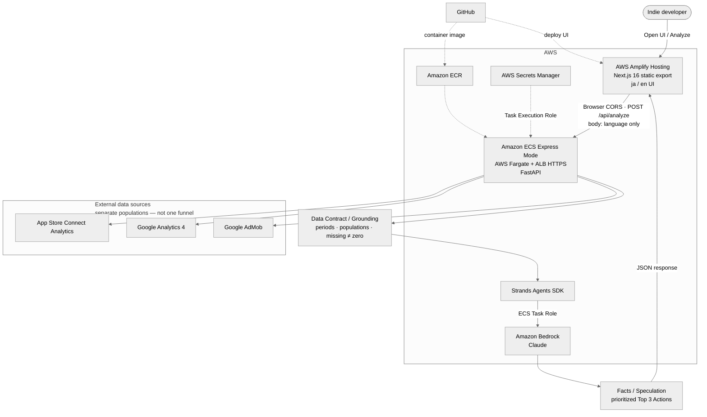

# Indie Growth Agent

[English](README.md) | [日本語](README.ja.md)

Growth-analysis agent for indie apps (Hackathon MVP).

It pulls observed metrics from App Store Connect, GA4, and AdMob, then returns **prioritized Top 3 Actions**—not a bare metric summary. The runtime is **Strands Agents SDK + Amazon Bedrock**, with a **Next.js static Web UI** (Japanese / English).

## Problem it solves

Indie developers often check ASC, GA4, and AdMob separately and pick priorities without aligned periods or populations.

This agent:

1. Fetches last-N-day vs prior-N-day facts from the three sources
2. Embeds a Data Grounding contract (periods, populations, missing data, no unstated causes)
3. Returns observation-based **Top 3 Actions** (and does not propose unconfirmed analytics features)

The point is not to summarize several dashboards into one narrative. It is to decide **where to start next**, with an explicit priority order, from the facts that are actually connected.

## Data Grounding

These rules are fixed in the system prompt and agent input text:

| Principle | Meaning |
|-----------|---------|
| Reporting period alignment | GA4 and AdMob use the same last-N / prior-N windows anchored on ASC `latest_processing_date` |
| Population scope | ASC (store / territory), GA4 (full property), and AdMob (configured app ID) are different populations |
| Missing data ≠ zero | A disconnected source, or a period/day with no rows, is not treated as proven zero performance (stated in the input). This does **not** mean every partial metric gap inside a connected source is classified as missing vs zero |
| Facts / Speculation separation | Only observable numbers are Facts; inferences go in Speculation frames |
| No ungrounded cross-source ratios | No division or funneling across sources unless the input states populations match (e.g. GA4 `ad_impression` ≠ AdMob `IMPRESSIONS`) |

LLM output is constrained by the prompt / Data Contract; there is no post-generation machine validation (see Known limitations).

## Connected sources (current)

| Source | Status | What we use |
|--------|--------|-------------|
| App Store Connect Analytics | Required | Impressions, product page views, first-time downloads, source breakdown, conversion rates, period-over-period change |
| Google Analytics 4 | Optional | activeUsers / sessions / screenPageViews, configured key events, period-over-period change |
| Google AdMob Network Report | Optional | ESTIMATED_EARNINGS / IMPRESSIONS / IMPRESSION_RPM (eCPM) / CLICKS, period-over-period change |

Unset sources are marked `not connected`; values are never invented.

## Repository layout

```
indie-growth-agent/
├── agent.py              # Shared analysis entry (fetch → format → Bedrock)
├── api_server.py         # FastAPI (local / container) for the Web UI
├── analysis_schema.py    # Structured Agent / API response models
├── report_builder.py     # Observed metrics + analysis → JSON for the UI
├── format_input.py       # Data Contract / FACTS text builder
├── config.py             # Loads .env (no hardcoded secrets)
├── event_definitions.json# Developer-declared GA4 event meanings
├── requirements.txt
├── Dockerfile            # Backend container image
├── .dockerignore
├── .env.example
├── asc/                  # App Store Connect fetch
├── ga4/                  # GA4 Data API fetch
├── admob/                # AdMob Network Report fetch
├── web/                  # Next.js 16 static-export Web UI
├── scripts/              # Connection checks / OAuth helpers
│   ├── verify_ga4.py
│   ├── verify_admob.py
│   ├── oauth_admob.py
│   └── list_ga4_events.py
└── secrets/              # Local only (gitignored): .p8 / refresh tokens, etc.
```

## Architecture

See **[docs/architecture.md](docs/architecture.md)** for the full architecture diagram (Mermaid) and request flow.



**3 data sources → grounded analysis → 1 priority list.** Secrets stay on the backend; the browser sends `{ language }` only.

Standalone Mermaid source: [`docs/architecture.mmd`](docs/architecture.mmd)

## Deployment

| Layer | Choice |
|-------|--------|
| Frontend | Next.js 16 **static export** on **AWS Amplify Hosting** |
| Backend | FastAPI container on **Amazon ECS Express Mode** (AWS Fargate) |
| Image | **Amazon ECR** |
| Public API URL | HTTPS endpoint provided by ECS Express Mode |
| Secrets | **AWS Secrets Manager** → task environment |
| Bedrock | **ECS Task Role** (no long-lived AWS access keys in the app) |
| ECR / Secrets at startup | **ECS Task Execution Role** |

Frontend build env: `NEXT_PUBLIC_AGENT_API_URL=<ECS HTTPS URL>`. Backend CORS: set `CORS_ALLOWED_ORIGINS` to the Amplify origin (localhost defaults remain for local use).

Not used: App Runner, Amplify SSR, Next.js API Route proxy.

## Setup

### 1. Python environment

Python 3.11+ recommended.

```bash
python3 -m venv .venv
source .venv/bin/activate
pip install -r requirements.txt
```

### 2. Configuration

```bash
cp .env.example .env
```

Put real values in `.env` and secrets under `secrets/` (both are gitignored).

Minimum requirements:

- **App Store Connect**: Issuer ID / Key ID, target app, territory; local `.p8` via `APP_STORE_CONNECT_PRIVATE_KEY_PATH`, or PEM body via `APP_STORE_CONNECT_PRIVATE_KEY` (containers / Secrets Manager)
- **Amazon Bedrock (Strands default)**: Locally, credentials that can call Bedrock (e.g. `AWS_REGION` + profile / env vars). On ECS, use the **Task Role**—do not commit access keys
- **GA4 (optional)**: Property ID + OAuth (`GOOGLE_OAUTH_*` and refresh token) or a service account
- **AdMob (optional)**: Account ID + a separate-scope refresh token (`scripts/oauth_admob.py`) + `ADMOB_APP_IDS` when needed

See `.env.example` for key names. For the Web UI, set `NEXT_PUBLIC_AGENT_API_URL` in `web/.env.local` (see `web/README.md`).

### 3. Optional connection checks

```bash
python scripts/verify_ga4.py
python scripts/verify_admob.py
```

## Run

CLI:

```bash
python agent.py
```

Stdout prints the agent input (Data Contract + FACTS) and the Bedrock response (Most important finding / Why it matters / Top 3 actions).

Web UI (local):

```bash
# Terminal 1 — API
python api_server.py

# Terminal 2 — static-capable Next.js app
cd web
cp .env.example .env.local   # NEXT_PUBLIC_AGENT_API_URL=http://127.0.0.1:8000
npm install && npm run dev
```

The browser calls the FastAPI `/api/analyze` endpoint directly (no Next.js API Route proxy).

## Roadmap

### Hackathon MVP (implemented)

Already in this repository:

- App Store Connect analytics fetch
- GA4 fetch (optional when configured)
- AdMob Network Report fetch (optional when configured)
- Strands Agents SDK + Amazon Bedrock analysis
- Facts / Speculation grounding
- Reporting period alignment
- Population scope
- Missing data ≠ zero
- Prioritized Top 3 Actions
- Next.js 16 static-export Web UI (Amplify-ready)
- FastAPI that runs the Agent for the Web UI (local / container)
- Japanese / English UI
- Container + Amplify / ECS Express Mode deployment support

### Future Roadmap (not implemented)

#### Next

- Google Play / Android support
- App selector
- App Store reviews
- IAP / subscriptions
- RevenueCat integration

#### Later

- Portfolio analysis across multiple apps
- Proactive growth alerts
- Historical learning from previous recommendations and outcomes

#### Long-term vision

Indie Growth Agent should evolve from analyzing one configured app into a growth partner for indie developers that helps decide not only what action to take, but which app deserves the developer's limited time next.

```
Acquisition → Usage → Feedback → Revenue → Prioritized action
```

Also still out of scope for now:

- Amazon Bedrock AgentCore (this project uses Amplify Hosting + ECS Express Mode instead)
- Post-generation machine grounding checks (schema / citation validation, etc.)
- Explicit AdMob partial-metric missing handling (distinguish missing vs zero)

## Known limitations (MVP)

- **Source populations may differ** — matching calendars do not make ASC / GA4 / AdMob the same population
- **AdMob partial metric missing handling is not implemented** — response gaps are not strictly distinguished from true zeros
- **LLM output is grounded by prompt / data contract but not machine-validated after generation** — no post-hoc output validator
- **Public analyze API** — the ECS HTTPS endpoint is callable from the browser; protect it in production (e.g. WAF / rate limits). Long-running Analyze also needs an ALB idle timeout above the default 60s

## License

MIT License. See [LICENSE](LICENSE).
