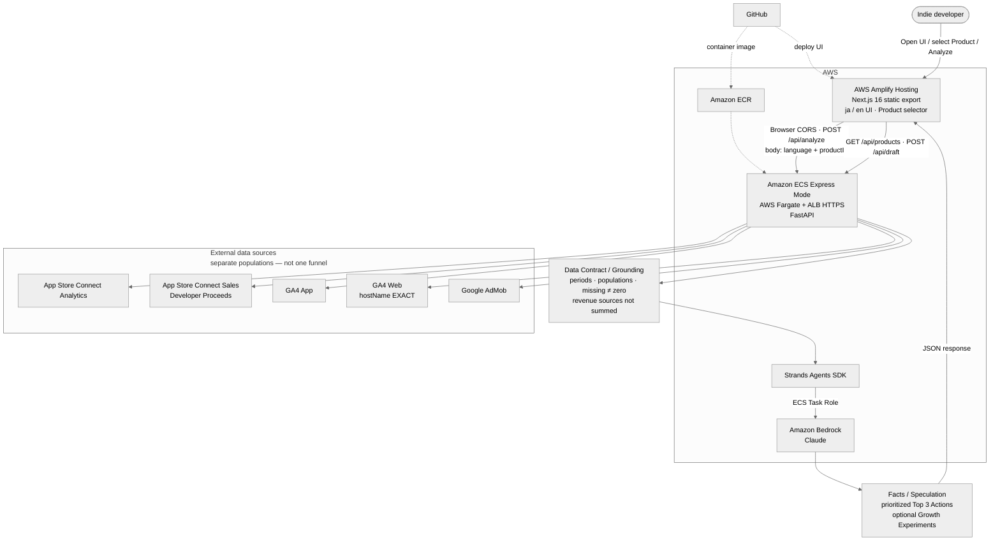
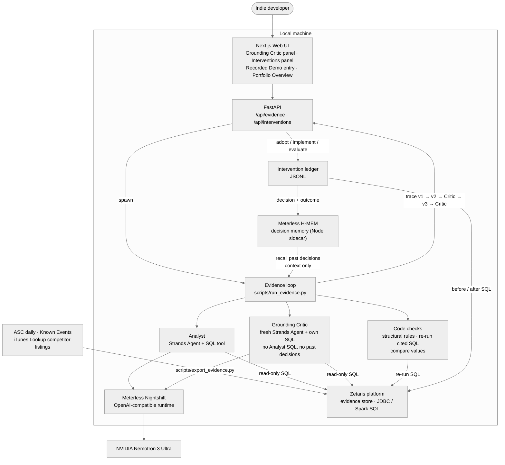

# Indie Growth Agent

[English](README.md) | [日本語](README.ja.md)

Growth-analysis agent for indie apps (Hackathon MVP, extended for **Open Agent Hackathon 2026 — Track 2 "The Agent That Can Explain Why"**).

It pulls observed metrics from **connected Product channels** (App Store Connect Analytics, optional ASC Sales, GA4 App, GA4 Web, AdMob), then returns **prioritized Top 3 Actions**—not a bare metric summary. The runtime is **Strands Agents SDK** with a selectable model provider (**Amazon Bedrock** by default; **Meterless Nightshift → NVIDIA Nemotron** for the hackathon runs), with a **Next.js static Web UI** (Japanese / English) and a **Multi-Product** catalog (`products/`).

For the hackathon it adds an **evidence revision loop**: an Analyst proposes actions with claims, every number in a claim must come with SQL that reproduces it on an evidence store (**Zetaris** for real data), an independent **Grounding Critic** checks the claims with its own SQL, and the Analyst revises (v1 → v2 → Critic → v3 → Critic). Adopted actions are tracked as **interventions** with before/after numbers measured by SQL and a human verdict, and those outcomes are fed back to the next Analyst through **Meterless H-MEM** decision memory.

## Open Agent Hackathon 2026 — Track 2: The Agent That Can Explain Why

The track asks for an agent that can show **why** it recommends something, not just what. In this project "why" means:

- Each proposed action points at **claims**, and each claim is labeled **fact** (our own data), **observation** (public data about other apps), or **hypothesis** (needs a test plan)
- Every number in a fact or observation carries the **SQL that reproduces it** on the evidence store
- A separate **Critic** re-checks those numbers with SQL it writes itself; whether a number matches is decided by **code**, never by a model
- The full revision history (v1, v2, Critic findings, v3, the second review, unresolved findings) is saved as a trace and shown in the Web UI
- After a person acts on a proposal, the measured result and their verdict become context for the next analysis

### Built during the hackathon (this repository, `open-agent-2026` branch)

| Area | What was added |
|------|----------------|
| Evidence loop | Evidence schema, read-only SQL guard, SQLite and Zetaris evidence stores, evidence tables from ASC daily data / Known Events / competitor listings, Analyst + Grounding Critic loop (`evidence/`) |
| Model provider | Every Strands Agent goes through `llm.build_model()`: `bedrock` (default), `openai_compatible`, `meterless` (Meterless Nightshift, pinned to NVIDIA Nemotron 3 Ultra) |
| Interventions | Adopt an AI action or register one by hand; implement → evaluate lifecycle; before/after measured by SQL; human verdict (`interventions/`, `scripts/interventions.py`) |
| Decision memory | `none` / `local` (JSONL) / `hmem` (Meterless H-MEM reference, Node sidecar). Past decisions and outcomes are recalled before each evidence run (`memory/`, `integrations/hmem/`) |
| API | `/api/evidence` (list / read / start runs), `/api/interventions` (adopt, add, implement, evaluate, measure, drop) |
| Web UI | Grounding Critic revision-history panel, Interventions panel, Portfolio Overview (`/portfolio`), Recorded Demo entry button on the dashboard |
| Sample mode | Fictional mahjong sample CSVs with two scenarios, Live Sample runs on a dedicated SQLite file, two committed Recorded Demo traces with review notes |
| Tests | `scripts/verify_offline.py` runs 18 offline checks (no credentials, network, or model) |

Everything before the hackathon (Analyze, Data Grounding, Multi-Product, ASC / GA4 / AdMob fetchers, Planner, Draft, AWS deployment) is listed in [`docs/pre-existing-work.md`](docs/pre-existing-work.md).

## Problem it solves

Indie developers often check ASC, GA4, and AdMob separately and pick priorities without aligned periods or populations.

This agent:

1. Fetches last-N-day vs prior-N-day facts from the Product’s connected sources
2. Embeds a Data Grounding contract (periods, populations, missing data, no unstated causes, no ungrounded revenue summing)
3. Returns observation-based **Top 3 Actions** (and does not propose unconfirmed analytics features)
4. (Evidence loop) Makes every number behind a proposal reproducible by SQL, has an independent Critic check it, and keeps the revision history

The point is not to summarize several dashboards into one narrative. It is to decide **where to start next**, with an explicit priority order, from the facts that are actually connected—for the selected Product.

## Evidence revision loop (v1 → v2 → Critic → v3 → Critic)

Implemented in `evidence/loop.py`, `evidence/critic.py`, `evidence/agents.py`. Run from the CLI (`scripts/run_evidence.py`) or the Web UI (which spawns the same script).

| Step | Who | What happens |
|------|-----|--------------|
| v1 | Analyst | Uses only our own tables (`asc_daily`, `asc_daily_by_source`, `known_events`). Latest 7 days vs the 7 days before, anchored on the newest `asc_daily` row |
| v2 | Analyst | Adds the public competitor table (`competitor_listing`). Claims citing it are observations, not facts |
| Critic round 1 | Code + Critic | See below. No findings → `converged` |
| v3 | Analyst | Answers each finding (`fixed` / `downgraded` / `removed` / `disputed`) and records how each action changed (`kept` / `modified` / `removed`) |
| Critic round 2 | Code + Critic | Same review on v3. Findings still open after the last round (default 2, CLI `--max-rounds` 1–3) are marked `unresolved` and the run ends as `max_rounds` |

**What each Critic round does**

1. **Structural rules (code)**: evidence present, cited tables exist, one number per evidence item, facts need SQL, public data about other apps cannot be a fact, a hypothesis needs a test plan, an action cannot rest only on competitor observations
2. **Re-run the Analyst's cited SQL (code)**: the result must equal the written value at the precision it was written (a ratio written as a percent also matches)
3. **Independent Critic (model)**: a fresh Strands Agent with no shared conversation. It sees claims and actions **without the Analyst's SQL or reasoning**, and never sees past decisions. It writes its own SQL checks and can raise `causal_leap`, `scope_mismatch`, `kind_mislabel`, `unverifiable`, or `infeasible_action` (an App Store limit the action or test plan breaks)
4. **Compare values (code)**: each Critic SQL result is compared with the claim's evidence values by code; a mismatch becomes a `value_mismatch` finding

**Guards before review**

- All SQL from both models passes a read-only guard (single `SELECT` / `WITH`, no write keywords); SQLite also has a read-only authorizer
- A v1/v2 answer that states numeric facts without any successful SQL in that answer is rejected and retried once; a second rejection stops the run, so invented numbers never reach the Critic
- A revision that drops every action without a stated reason is rejected the same way

The trace (`tmp/evidence_runs/<run_id>.json`) is rewritten after every step and holds each version, all SQL calls (Analyst / Critic / code), Critic findings and their resolution (`resolved` / `downgraded` / `unresolved`), rejected attempts, durations, and the model label.

**Scope:** the evidence loop currently covers App Store Connect daily data, Known Events, and public competitor listings (iTunes Lookup). GA4 and AdMob are used by the Live Analyze path only. The evidence loop and Live Analyze are separate runs; the loop does not read the Live Analyze Top 3.

## Interventions, measurement, human evaluation, and feedback

Implemented in `interventions/`, `interventions_api.py`, `scripts/interventions.py`, and the Web UI Interventions panel.

```
Adopt AI action / register by hand → planned
  → implement (date)  → "before" window measured by SQL
  → evaluate (verdict) → "after" window measured by SQL + human verdict
  → decision and outcome copied to decision memory
  → next evidence run: recalled as "past decisions" for the Analyst
```

- **Adopt or register**: adopt one action (rank 1–3) of a finished real-data run, or register a change a person came up with. An adopted action keeps the AI proposal (claims, test plan, model, version) unchanged. Runs on fictional sample data cannot be adopted
- **Plan**: target metric, method, success criterion, days until evaluation, window length. Metrics: `impressions`, `product_page_views`, `first_time_downloads`, `impression_to_page_view_pct`, `page_view_to_download_pct`
- **Before / after**: computed by code with SQL on `asc_daily` in the evidence store (window before the implementation date / window after it). A window is measured only if every day has a row; a partial window is reported as skipped, never summed over fewer days. Numbers are never typed in
- **Human evaluation**: `improved` / `no_change` / `worse` / `inconclusive`, with a note. Evaluating before the evaluation date needs an explicit "early" flag
- **Feedback to the next Analyst**: decisions are written to memory when a person adopts or registers one, and outcomes when they evaluate. Running an analysis never writes memory. Before each real-data evidence run, memory is searched for this product, each hit is read back from the ledger (dropped ones are skipped), and the Analyst receives them as **context only, not evidence**—it must re-query the store for any number. The Critic never receives them
- **Storage**: the ledger (`INTERVENTIONS_PATH`, default `tmp/interventions/ledger.jsonl`) is the record whatever `MEMORY_BACKEND` is; memory holds a readable copy (`sync-memory` re-links later)

## Sponsor technologies and their roles

| Technology | Role in this project | Where |
|------------|----------------------|-------|
| **Zetaris** | Evidence store for real data (`EVIDENCE_STORE=zetaris`). Evidence tables are staged as CSV into the local Zetaris platform and registered as Lightning filestore tables; Analyst SQL, Critic SQL, code re-checks, and intervention before/after measurement all run there over JDBC (Spark SQL) | `integrations/zetaris/` |
| **Meterless Nightshift** | Local OpenAI-compatible model runtime (`LLM_PROVIDER=meterless`). Every Strands Agent (Analyst, Critic, Analyzer, Planner, Draft) sends requests to it with a `meterless-app` header so runs are recorded per app. Analyst / Critic requests that fail for a retryable reason are retried once, and provider errors are logged with their details | `integrations/meterless/`, `llm/` |
| **NVIDIA Nemotron** | The model behind the Analyst and Critic in the hackathon runs: `nvidia/nemotron-3-ultra-550b-a55b`, reached through Nightshift's NVIDIA provider (pinned because `meterless/auto` routed to a model that returned 404 on this machine) | `METERLESS_MODEL` |
| **Meterless H-MEM** | Decision memory backend (`MEMORY_BACKEND=hmem`). The official reference implementation is vendored and run as a Node.js sidecar; decisions and outcomes are stored per product and recalled before each evidence run | `integrations/hmem/` |
| Strands Agents SDK | Agent runtime for every model call, including structured output and the SQL tool | `agent.py`, `evidence/agents.py` |
| Amazon Bedrock | Default model provider (`LLM_PROVIDER` unset or `bedrock`) and the provider of the AWS deployment | `llm/factory.py` |

The Live Sample and Recorded Demo use a dedicated SQLite file, not Zetaris, so fictional data never enters the real evidence store.

## Multi-Product

Analysis is scoped to one **Product** at a time (catalog in `products/index.json` + per-product JSON).

- **CLI**: `python agent.py --product-id <id>` (default from `products/index.json`)
- **API**: `GET /api/products` lists products; `POST /api/analyze` accepts `{ language, productId }`
- **Web UI**: Product selector in the header; switching Product loads that Product’s **last successful Analyze** from localStorage (or an empty shell)

### Portfolio Overview (display) vs portfolio analysis (not implemented)

- **Portfolio Overview (`/portfolio`, implemented)**: one card per configured app, showing that app's **last successful Live Analyze saved in this browser** (period, top recommendation, two key metrics per source block, run id), or "not analyzed". It reads localStorage only; it does **not** call the API to analyze, generate values, or create recommendations
- **Cross-app portfolio analysis (not implemented)**: comparing apps and deciding which app deserves the developer's time next. Each card is still a separate single-Product result; numbers on different cards are not compared or ranked

## Data Grounding

These rules are fixed in the system prompt and agent input text:

| Principle | Meaning |
|-----------|---------|
| Reporting period alignment | GA4 and AdMob use the same last-N / prior-N windows anchored on ASC `latest_processing_date` |
| Population scope | ASC Analytics (store / territory), GA4 App (property-wide unless filtered), GA4 Web (`hostName` EXACT when configured), AdMob (configured app ID), and ASC Sales Revenue (worldwide Trends) are **different populations** |
| Missing data ≠ zero | A disconnected source, or a period/day with no rows, is not treated as proven zero performance (stated in the input). This does **not** mean every partial metric gap inside a connected source is classified as missing vs zero |
| Facts / Speculation separation | Only observable numbers are Facts; inferences go in Speculation frames |
| No ungrounded cross-source ratios | No division or funneling across sources unless the input states populations match (e.g. GA4 `ad_impression` ≠ AdMob `IMPRESSIONS`) |
| Revenue sources stay separate | AdMob **ESTIMATED_EARNINGS** and App Store Sales **Developer Proceeds** are different sources (meaning, certainty, currency/scope). They are shown in parallel and **must not be summed** |

In the Live Analyze path, LLM output is constrained by the prompt / Data Contract; there is no post-generation machine validation there (see Known limitations). The evidence loop adds machine checks (SQL re-runs, structural rules, the Critic) for its own proposals. Evidence tables keep population columns (`territory`, `country`, `source`) and keep missing values as NULL, never 0.

## Connected sources (current)

| Source | Status | What we use |
|--------|--------|-------------|
| App Store Connect Analytics | Required (when App Store channel enabled) | Impressions, product page views, first-time downloads, source breakdown, conversion rates, period-over-period change |
| App Store Connect Sales (Trends) | Optional | Units × **Developer Proceeds** (estimated, not Financial Partner Share); period-over-period change. Scope is typically worldwide and must not be treated as identical to ASC Analytics territory |
| Google Analytics 4 **App** | Optional | activeUsers / sessions / screenPageViews, configured **App** key events, period-over-period change (property-wide unless the product config adds filters) |
| Google Analytics 4 **Web** | Optional | activeUsers / sessions / page views for a configured hostname (`hostName` EXACT), optional **Web** key events / `featurePaths` / page-path scopes, period-over-period change |
| Google AdMob Network Report | Optional | ESTIMATED_EARNINGS / IMPRESSIONS / IMPRESSION_RPM (eCPM) / CLICKS, period-over-period change |

Unset sources are marked `not connected`; values are never invented.

Revenue UI shows AdMob estimated earnings and App Store developer proceeds as **separate** rows—different meaning and certainty; do not add them into one total.

### Evidence tables (evidence loop)

Loaded by `scripts/export_evidence.py` into `EVIDENCE_STORE`:

| Table | Source | Kind |
|-------|--------|------|
| `asc_daily` | App Store Connect Analytics daily totals (needs ASC credentials) | Our data → facts |
| `asc_daily_by_source` | ASC daily impressions / first-time downloads by search / browse / referrer | Our data → facts |
| `known_events` | Developer-written context (`known_events.json`) | Context only; nearness does not prove cause |
| `competitor_listing` | Public App Store listing (iTunes Lookup, no key) for our app and the fixed competitor list in the Product JSON (`competitors`) | External → observations |

## Sample data, Live Sample, and Recorded Demo

For the demo there is a **fictional** mahjong sample in `samples/mahjong/` (`sample_mode.py`). Every number, app, and listing in it is made up (`source = fictional_sample`, app id `fictional-001`); loading refuses data that names a configured real app.

| Scenario | Content |
|----------|---------|
| `base` | 14 days (2026-10-09 to 2026-10-22). Impressions up 40% in the latest 7 days while the page-view rate and first-time downloads fell; browse impressions grew most; top competitors lead in rating count, screenshot count, and update recency |
| `competitor-variant` | Same as `base` except one competitor (`fictional-101`) loses those three leads. Every changed cell is listed with old value, new value, and reason in `scenarios.json` |

Three ways to use it, kept apart:

| Mode | Model call | Store | How |
|------|-----------|-------|-----|
| **Fictional CSV only** | No | `tmp/sample/<scenario>.sqlite` | `python scripts/run_sample.py --scenario base --dry-run` loads the CSVs (plus scenario changes), prints the periods and row counts, and stops |
| **Live Sample** | Yes (`LLM_PROVIDER`) | Dedicated SQLite, `EVIDENCE_STORE` ignored | `python scripts/run_sample.py --scenario base` runs the real Analyst and Critic. No past decisions are recalled. Trace: `tmp/evidence_runs/sample-<scenario>-<timestamp>.json` + `.sample.json` |
| **Recorded Demo** | No (no API key, network, or model) | Committed trace | Traces in `samples/recorded/`, copied from Live Sample runs only after checks (`scripts/record_sample_demo.py`: sample run id, unchanged CSVs, finished, model recorded, at least one Critic review) |

**Committed Recorded Demos** (both ended at the review limit; not every finding is resolved):

| Run | Model label in the trace | Result | Run time |
|-----|--------------------------|--------|----------|
| `sample-base-20261024-214121` | `openai_compatible:nvidia/nemotron-3-ultra-550b-a55b` | `max_rounds`, 1 unresolved finding in v3 | about 15 min |
| `sample-competitor-variant-20261024-220111` | `openai_compatible:nvidia/nemotron-3-ultra-550b-a55b` | `max_rounds`, 8 unresolved findings in v3 (2 are known false judgments) | about 24 min |

Both were run through Nightshift's OpenAI-compatible endpoint before the dedicated `LLM_PROVIDER=meterless` provider was added, so the trace says `openai_compatible`. Each `.sample.json` carries a review outcome, known limitations, and a comparison note (in Japanese and English). The difference between the two scenarios must **not** be read as a causal effect of the competitor data change: one run per scenario cannot separate model variance from the data difference, and the run conditions differed.

**Playing the Recorded Demo**

```bash
# CLI: every recorded run, then base vs competitor-variant
python scripts/show_sample_demo.py
python scripts/show_sample_demo.py --run-id sample-base-20261024-214121
```

In the Web UI (needs `python api_server.py` and `npm run dev`, no model credentials): press the **Recorded Demo** entry button at the top of the dashboard. It switches to the run's Product (mahjong), selects the `base` Recorded Demo in the Grounding Critic revision history, and scrolls to it. Both Recorded Demos are also in the run selector, labeled `[Recorded Demo: <scenario>]`; Live Sample runs are labeled `[Live Sample: <scenario>]`. The Recorded Demo is shown inside the dashboard panel; a **standalone Recorded Demo screen is not implemented**.

## Repository layout

```
indie-growth-agent/
├── agent.py                 # Shared analysis entry (fetch → format → model)
├── api_server.py            # FastAPI: /api/products, /api/analyze, /api/draft (+ evidence / interventions routers)
├── evidence_api.py          # /api/evidence: list, read, start evidence runs
├── interventions_api.py     # /api/interventions: adopt, add, implement, evaluate, measure, drop
├── analysis_schema.py       # Structured Agent / API response models
├── report_builder.py        # Observed metrics + analysis → JSON for the UI
├── format_input.py          # Data Contract / FACTS text builder
├── product_config.py        # Multi-Product catalog loader
├── planner.py               # Optional growth-experiment planner (MCP / playbooks)
├── draft_generator.py       # Action Draft generator
├── known_events.py          # Known product events for Planner context
├── sample_mode.py           # Fictional sample data, scenarios, Recorded Demo rules
├── config.py                # Loads .env / process env (no hardcoded secrets)
├── event_definitions.json   # Developer-declared GA4 App event meanings (example)
├── event_definitions_web.json
├── known_events.json
├── products/                # Product catalog
│   ├── index.json
│   ├── mahjong.json
│   ├── shopping-memo.json
│   └── nextuta.json
├── evidence/                # Evidence schema, stores, SQL guard, Analyst / Critic, revision loop
├── interventions/           # Ledger, lifecycle, SQL measurement, memory link
├── memory/                  # Decision memory interface (none / local) and recall
├── llm/                     # Model provider selection and provider error handling
├── integrations/
│   ├── zetaris/             # Zetaris evidence store (JDBC, CSV staging)
│   ├── meterless/           # Meterless Nightshift settings and runtime status
│   └── hmem/                # Meterless H-MEM adapter + vendored reference (Node sidecar)
├── samples/
│   ├── mahjong/             # Fictional sample CSVs + scenarios.json
│   └── recorded/            # Committed Recorded Demo traces + .sample.json notes
├── requirements.txt
├── Dockerfile               # Backend container image
├── .dockerignore
├── .env.example
├── asc/                     # App Store Connect Analytics + Sales
│   └── sales.py
├── ga4/                     # GA4 App + GA4 Web Data API fetch
├── admob/                   # AdMob Network Report fetch
├── web/                     # Next.js 16 static-export Web UI
├── scripts/                 # Run / record / show scripts, connection checks, offline verification
│   ├── run_evidence.py      # Evidence loop on real data
│   ├── export_evidence.py   # Load evidence tables into EVIDENCE_STORE
│   ├── interventions.py     # Intervention CLI
│   ├── run_sample.py        # Live Sample (or --dry-run)
│   ├── record_sample_demo.py
│   ├── show_sample_demo.py  # Recorded Demo viewer
│   ├── check_meterless.py   # Nightshift status
│   ├── verify_offline.py    # All offline checks
│   ├── verify_ga4.py
│   ├── verify_admob.py
│   ├── oauth_admob.py
│   └── list_ga4_events.py
├── docs/                    # Architecture, pre-existing work
└── secrets/                 # Local only (gitignored): .p8 / refresh tokens, etc.
```

## Architecture

See **[docs/architecture.md](docs/architecture.md)** for the full architecture diagrams (Mermaid) and request flows.

### Live Analyze (AWS deployment)



**Connected sources → grounded analysis → 1 priority list.** Secrets stay on the backend (process environment). The browser sends `{ language, productId }` for Analyze (no API keys). Optional Draft posts experiment context and screenshots to `/api/draft`.

Standalone Mermaid source: [`docs/architecture.mmd`](docs/architecture.mmd)

### Evidence loop and interventions (hackathon, local)



The Live Sample uses the same loop on `tmp/sample/<scenario>.sqlite` instead of Zetaris, with no memory recall. The Recorded Demo is read from `samples/recorded/` with no model.

## Web UI behavior (current)

- **Initial view**: last successful Live Analyze for the selected Product (`localStorage`), or an empty shell prompting Analyze
- **Analyze latest data**: refreshes via `POST /api/analyze`, then updates the UI and cache
- **Loading / empty / error**: Analyze progress (elapsed seconds), empty states before first success, retry on Analyze failure
- **i18n / a11y**: Japanese / English UI chrome; focus-visible and localized labels where applicable
- **Language switch**: changes UI chrome immediately and is kept across pages. It does **not** re-run Analyze or rewrite existing analysis prose; Actions / Facts / Experiments stay in the language of the last successful Analyze until the user runs Analyze again
- **Recorded Demo entry** (top of the dashboard): opens the committed `base` Recorded Demo in the revision history below (no model call)
- **Grounding Critic panel** (under Top 3): run selector, "Run a new verification" (confirmation; one run started from the API at a time), v1 / v2 / v3 steps, claims with evidence and SQL, Critic findings with resolution, and an adopt button per action on finished real-data runs. Fictional-data runs show a banner with the review outcome, unresolved count, scenario changes, known limitations, and comparison note
- **Interventions panel**: list, add by hand, mark implemented, record verdict, re-measure, drop; shows the AI prediction, before / after numbers, skipped windows, and your verdict
- **Portfolio Overview** (`/portfolio`, header link): one card per app from saved Live Analyze results (see Multi-Product)

Details: [`web/README.md`](web/README.md)

## Deployment

| Layer | Choice |
|-------|--------|
| Frontend | Next.js 16 **static export** on **AWS Amplify Hosting** |
| Backend | FastAPI container on **Amazon ECS Express Mode** (AWS Fargate) |
| Image | **Amazon ECR** |
| Public API URL | HTTPS endpoint provided by ECS Express Mode |
| Runtime config | Process **environment variables** (`config.py` / `.env`). In ECS, values may be **injected** into the task environment from **AWS Secrets Manager** (Task Execution Role)—the app does not call Secrets Manager APIs itself |
| Bedrock | **ECS Task Role** (no long-lived AWS access keys in the app) |
| ECR pull at startup | **ECS Task Execution Role** |

Frontend build env: `NEXT_PUBLIC_AGENT_API_URL=<ECS HTTPS URL>`. Backend CORS: set `CORS_ALLOWED_ORIGINS` to the Amplify origin (localhost defaults remain for local use).

Not used: App Runner, Amplify SSR, Next.js API Route proxy.

The hackathon additions (evidence loop, Zetaris, Meterless Nightshift, H-MEM) run **locally**. The Dockerfile and the AWS deployment were not updated for them (no Java / Node in the image, and Nightshift / Zetaris run on the developer's machine).

## Setup

### 1. Python environment

Python 3.11+ recommended.

```bash
python3 -m venv .venv
source .venv/bin/activate
pip install -r requirements.txt
```

### 2. Configuration

```bash
cp .env.example .env
```

Put real values in `.env` and secrets under `secrets/` (both are gitignored). Product channel IDs live under `products/` (preferred over legacy env-only overlays for multi-product).

Minimum requirements:

- **App Store Connect**: Issuer ID / Key ID, target app / territory (often from Product JSON); local `.p8` via `APP_STORE_CONNECT_PRIVATE_KEY_PATH`, or PEM body via `APP_STORE_CONNECT_PRIVATE_KEY` (containers; may be supplied via task env / Secrets Manager injection)
- **Model provider**: `LLM_PROVIDER` unset / `bedrock` uses Amazon Bedrock (locally, credentials that can call Bedrock, e.g. `AWS_REGION` + profile; on ECS, the **Task Role**—do not commit access keys). `.env.example` sets `LLM_PROVIDER=meterless` for the hackathon setup (see below)
- **GA4 App / Web (optional)**: Property IDs + OAuth (`GOOGLE_OAUTH_*` and refresh token) or a service account; Web hostname / key events / featurePaths come from Product JSON when enabled
- **AdMob (optional)**: Account ID + a separate-scope refresh token (`scripts/oauth_admob.py`) + app IDs when needed

See `.env.example` for key names. For the Web UI, set `NEXT_PUBLIC_AGENT_API_URL` in `web/.env.local` (see `web/README.md`).

### 3. Hackathon stack (optional; each part falls back to a local default)

| Variable | Default | Purpose |
|----------|---------|---------|
| `LLM_PROVIDER` | `bedrock` | `bedrock` / `openai_compatible` / `meterless` |
| `METERLESS_BASE_URL` | `http://127.0.0.1:8088/v1` | Nightshift runtime (any pasted form is normalized to `<host>/v1`) |
| `METERLESS_RUNTIME_TOKEN` | — (required for `meterless`) | Token Nightshift writes to `<stateDir>/proxy-token` (`rt-local` is rejected) |
| `METERLESS_MODEL` | `nvidia/nemotron-3-ultra-550b-a55b` | Model id sent to Nightshift |
| `METERLESS_APP` / `METERLESS_TIMEOUT_SECONDS` / `METERLESS_TTFB_MS` | `indie-growth-agent` / `600` / `240000` | App id header, request timeout, time to first token |
| `OPENAI_COMPATIBLE_BASE_URL` / `_API_KEY` / `_MODEL` / `_HEADERS` / `_TIMEOUT_SECONDS` | — | For `LLM_PROVIDER=openai_compatible` |
| `EVIDENCE_STORE` | `sqlite` | `sqlite` / `zetaris` |
| `EVIDENCE_SQLITE_PATH` | `tmp/evidence.sqlite` | SQLite evidence store |
| `ZETARIS_USER` / `ZETARIS_PASSWORD` | — | Zetaris login (`.env` only) |
| `ZETARIS_JDBC_JAR` / `ZETARIS_JAVA_HOME` / `ZETARIS_JDBC_URL` / `ZETARIS_DATABASE` | — / `JAVA_HOME` / `jdbc:zetaris:lightning@localhost:10000` / `INDIE_GROWTH` | JDBC driver (Java 17+ via JPype) |
| `ZETARIS_DOCKER_CONTAINER` / `ZETARIS_STAGING_DIR` / `ZETARIS_QUERY_TIMEOUT_SECONDS` | `zetaris-driver-1` / `/home/zetaris/customer-data/shared/indie_growth` / `60` | Where CSVs are staged inside the Zetaris container |
| `MEMORY_BACKEND` | `none` | `none` / `local` / `hmem` |
| `MEMORY_LOCAL_DIR` | `tmp/memory` | JSONL memory |
| `HMEM_DIR` / `HMEM_NODE` / `HMEM_RECALL_THRESHOLD` | `tmp/hmem` / `node` / `0.25` | H-MEM sidecar (Node.js 22.7+, no npm packages) |
| `INTERVENTIONS_PATH` | `tmp/interventions/ledger.jsonl` | Intervention ledger |

Prerequisites when enabled: Meterless Nightshift running locally; the local Zetaris platform running in Docker plus Java 17+ and the Zetaris JDBC jar; Node.js 22.7+ for H-MEM.

### 4. Optional connection checks

```bash
python scripts/verify_ga4.py
python scripts/verify_admob.py
python scripts/check_meterless.py            # Nightshift status (GET /v1/models, no model request)
python scripts/check_meterless.py --chat     # plus one short request (spends provider credits)
EVIDENCE_STORE=zetaris python scripts/verify_zetaris_live.py   # live Zetaris check (Docker)
```

## Run

CLI:

```bash
python agent.py
# or
python agent.py --product-id mahjong
```

Stdout prints the agent input (Data Contract + FACTS) and the model response (Most important finding / Why it matters / Top 3 actions).

Evidence loop on real data:

```bash
python scripts/export_evidence.py --product-id mahjong      # load evidence tables into EVIDENCE_STORE
python scripts/run_evidence.py --product-id mahjong         # v1 → v2 → Critic → v3 → Critic (default 2 rounds)
python scripts/run_evidence.py --product-id mahjong --language en --max-rounds 3
```

The first lines name the model provider, the evidence store (with its `asc_daily` rows), and the memory backend actually used. One run takes several minutes per step (the Recorded Demos took about 15 and 24 minutes).

Interventions:

```bash
python scripts/interventions.py adopt --run <run_id> --rank 1
python scripts/interventions.py add --product mahjong --title "..." \
    --metric page_view_to_download_pct --method "before/after 14 days" --criterion "+5 points" --days 14
python scripts/interventions.py implement <id> --on 2026-10-25
python scripts/interventions.py evaluate <id> --verdict inconclusive --note "..."
python scripts/interventions.py measure <id>      # re-measure (late data, store was down)
python scripts/interventions.py list --product mahjong
python scripts/interventions.py sync-memory
```

Sample data:

```bash
python scripts/run_sample.py --scenario base --dry-run           # fictional CSV only, no model
python scripts/run_sample.py --scenario competitor-variant       # Live Sample (model call)
python scripts/record_sample_demo.py <sample-run-id>             # keep as Recorded Demo
python scripts/show_sample_demo.py                               # Recorded Demo, no model
```

Web UI (local):

```bash
# Terminal 1 — API
python api_server.py

# Terminal 2 — static-capable Next.js app
cd web
cp .env.example .env.local   # NEXT_PUBLIC_AGENT_API_URL=http://127.0.0.1:8000
npm install && npm run dev
```

The browser calls FastAPI directly (no Next.js API Route proxy):

- `GET /api/products`
- `POST /api/analyze` with `{ language, productId }`
- `POST /api/draft` (optional Action Draft)
- `GET /api/evidence/runs`, `GET /api/evidence/runs/{runId}`, `POST /api/evidence/runs` (starts `scripts/run_evidence.py`; one at a time)
- `GET /api/interventions`, `POST /api/interventions`, `POST /api/interventions/adopt`, `POST /api/interventions/{id}/implement | evaluate | measure | drop`

## Tests

All offline (no credentials, network, or model calls):

```bash
python scripts/verify_offline.py   # 18 checks: import smoke + every verify_* script below
cd web && npm test                 # Web unit tests (portfolio, sample text, Recorded Demo entry)
cd web && npm run lint && npm run build
```

`verify_offline.py` runs each check in its own subprocess: Analyze cache, LLM provider selection, OpenAI-compatible and Meterless providers (local fake servers), structured output lists, evidence schema, SQL guard and SQLite store, evidence tables, Zetaris store (fake engine), evidence loop and Critic rules (stub models), `/api/evidence`, decision memory, H-MEM conformance suite + adapter (skipped without Node.js), interventions, `/api/interventions`, sample mode, and the memory → evidence-run integration.

Not part of the offline suite (need live services): `verify_ga4.py`, `verify_admob.py`, `verify_zetaris_live.py`, `check_meterless.py`.

## Roadmap

### Hackathon MVP (implemented)

Already in this repository:

- Multi-Product catalog (`products/`) + Product selector in the Web UI
- `GET /api/products`, Analyze `{ language, productId }`, optional `POST /api/draft`
- App Store Connect Analytics fetch
- App Store Connect Sales Developer Proceeds (optional, separate revenue source)
- GA4 App fetch (optional when configured)
- GA4 Web fetch with hostname scope / Web key events / featurePaths (optional when configured)
- AdMob Network Report fetch (optional when configured)
- Strands Agents SDK + Amazon Bedrock analysis
- Facts / Speculation grounding + revenue non-summing rules
- Reporting period alignment
- Population scope (including GA4 Web ≠ GA4 App)
- Missing data ≠ zero
- Prioritized Top 3 Actions
- Optional Growth Experiments (Planner) + Action Draft
- Next.js 16 static-export Web UI (Amplify-ready): last successful report cache, loading / empty / error, ja / en chrome
- FastAPI for the Web UI (local / container)
- Container + Amplify / ECS Express Mode deployment support

### Open Agent Hackathon 2026 (implemented)

- Selectable model provider (`bedrock` / `openai_compatible` / `meterless`) for every Strands Agent
- Evidence tables, read-only SQL guard, SQLite and Zetaris evidence stores
- Analyst + independent Grounding Critic revision loop (v1 → v2 → Critic → v3 → Critic) with code-side value checks and saved traces
- Interventions: AI adoption or manual registration, SQL before/after measurement, human verdict
- Decision memory (`local`, Meterless H-MEM) and recall of past decisions and outcomes as Analyst context
- `/api/evidence`, `/api/interventions`, Grounding Critic and Interventions panels in the Web UI
- Portfolio Overview (display of each app's saved Live Analyze)
- Fictional sample data, Live Sample, Recorded Demo (CLI viewer, dashboard entry button, labeled runs in the revision history)
- Offline verification runner

### Not finished yet

- **Standalone Recorded Demo screen**: today the Recorded Demo opens inside the dashboard's Grounding Critic panel
- **Faster evidence runs**: one run takes about 15–24 minutes with Nemotron 3 Ultra through Nightshift; no speed-up work has been done
- Reducing Critic false judgments seen in the Recorded Demos (counts compared with per-app values; finding kind not matching the content)

### Future Roadmap (not implemented)

#### Next

- Google Play / Android support
- App Store reviews
- IAP / subscriptions
- RevenueCat integration
- GA4 / AdMob tables in the evidence loop

#### Later

- Cross-Product **portfolio** analysis (compare / prioritize across Products—not the same as the existing single-Product selector or the display-only Portfolio Overview)
- Proactive growth alerts
- Evidence loop / Zetaris / Meterless / H-MEM in the AWS deployment

#### Long-term vision

Indie Growth Agent should evolve from analyzing one selected Product into a growth partner for indie developers that helps decide not only what action to take, but which Product deserves the developer's limited time next.

```
Acquisition → Usage → Feedback → Revenue → Prioritized action → Measured outcome
```

Also still out of scope for now:

- Amazon Bedrock AgentCore (this project uses Amplify Hosting + ECS Express Mode instead)
- Post-generation machine grounding checks for the Live Analyze Top 3 (the evidence loop has its own checks)
- Explicit AdMob partial-metric missing handling (distinguish missing vs zero)

## Known limitations (MVP)

- **Source populations may differ** — matching calendars do not make ASC Analytics / ASC Sales / GA4 App / GA4 Web / AdMob the same population
- **AdMob partial metric missing handling is not implemented** — response gaps are not strictly distinguished from true zeros
- **Live Analyze output is grounded by prompt / data contract but not machine-validated after generation** — only the evidence loop re-runs SQL and has a Critic
- **The Critic can be wrong and runs end with unresolved findings** — both Recorded Demos ended at the review limit (`max_rounds`) with unresolved findings, including known false `value_mismatch` judgments and a finding filed under the wrong kind. "Unresolved" means not verified, not proven wrong
- **Evidence runs are slow** — several minutes per step; about 15–24 minutes per run in the Recorded Demos
- **One run per scenario** — the Recorded Demos cannot separate model variance from the scenario difference
- **Evidence loop scope** — App Store Connect daily data, Known Events, and public listings only; competitor data is the public listing (no screenshots' content, no reviews)
- **Before / after measurement** reads `asc_daily` rows with territory `ALL` (the Product JSONs use `ALL`); a window with any missing day is skipped. The verdict is the person's, not a statistical test
- **Recorded Demo has no standalone screen** — it is opened inside the dashboard panel, and the Web UI needs the local API to show it
- **Live Sample model label** — with `LLM_PROVIDER=meterless`, `scripts/run_sample.py` records only `meterless` as the model (without the model id)
- **Hackathon stack is local only** — Zetaris, Nightshift, and H-MEM run on the developer's machine and are not in the AWS deployment
- **Public analyze API** — the ECS HTTPS endpoint is callable from the browser; protect it in production (e.g. WAF / rate limits). Long-running Analyze also needs an ALB idle timeout above the default 60s. `/api/evidence` and `/api/interventions` have no authentication either; run them locally
- **Language switch does not regenerate analysis** — UI chrome switches immediately; analysis body stays until the next Live Analyze

## License

MIT License. See [LICENSE](LICENSE). The vendored Meterless H-MEM reference keeps its own license in [`integrations/hmem/vendor/LICENSE`](integrations/hmem/vendor/LICENSE).
