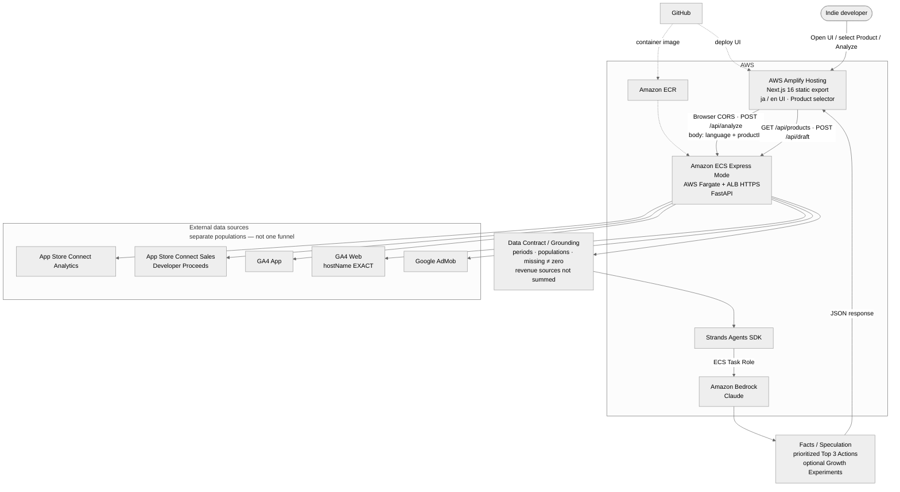
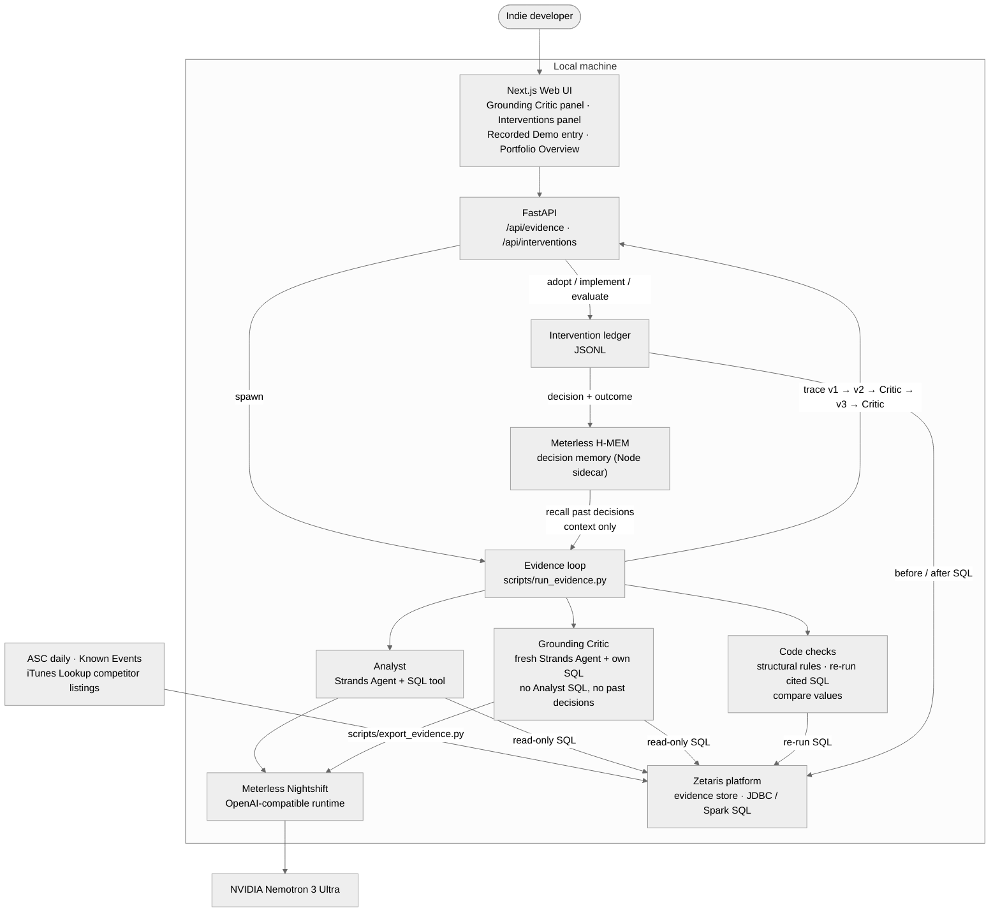

# Architecture — Indie Growth Agent

Hackathon architecture for **Indie Growth Agent**: connected Product channels become one grounded priority list.

**Value:** `connected sources → grounded analysis → 1 priority list`  
Not a multi-dashboard mashup. The agent applies a Data Contract (periods, populations, missing ≠ zero, revenue sources not summed), then returns **Facts / Speculation** and **prioritized Top 3 Actions** for the **selected Product**.

There are two flows:

1. **Live Analyze** (pre-existing, deployed on AWS): connected channels → Data Contract → one model call → Top 3 Actions
2. **Evidence loop and interventions** (Open Agent Hackathon 2026, runs locally): SQL-reproducible claims → independent Grounding Critic → revision → adopted interventions measured by SQL → outcomes recalled for the next run

## Diagram — Live Analyze (AWS deployment)

Source-only Mermaid file: [`architecture.mmd`](architecture.mmd)

## Request flow — Live Analyze

1. User opens the Amplify-hosted static Web UI, selects a **Product**, and sees the **last successful Live Analyze** for that Product from `localStorage` (or an empty shell).
2. Browser may call `GET /api/products` for the catalog. **Analyze** calls FastAPI `POST /api/analyze` on the ECS Express Mode HTTPS endpoint (CORS; body `{ language, productId }`).
3. Backend reads **process environment variables** (`config.py`; locally from `.env`). In ECS deploy, those values may be injected into the task environment from **AWS Secrets Manager**—the application does not call Secrets Manager APIs itself.
4. Backend loads the Product from `products/`, then fetches connected channels: App Store Connect Analytics, optional ASC Sales (Developer Proceeds), GA4 App, GA4 Web (`hostName` EXACT when configured), and AdMob.
5. Observed metrics are shaped into a **Data Contract / Grounding** prompt (aligned windows, separate populations including GA4 Web ≠ GA4 App, missing ≠ zero, AdMob earnings ≠ ASC Proceeds and must not be summed).
6. **Strands Agents SDK** invokes **Amazon Bedrock (Claude)** with the ECS **Task Role** (no long-lived AWS access keys in the container). Optional Planner may attach Growth Experiments. (Locally, `LLM_PROVIDER` can switch every Strands Agent to an OpenAI-compatible server or Meterless Nightshift; the AWS deployment uses the Bedrock default.)
7. Structured **Facts / Speculation / Top 3 Actions** (and optional experiments) JSON returns to the browser, renders in the UI, and is cached as the last successful report for that Product.
8. Optional **Action Draft**: browser `POST /api/draft` with experiment context (and optional screenshots); secrets still stay server-side.

**Language:** UI chrome switches with the language control immediately. Switching language alone does **not** re-run Analyze or regenerate existing analysis prose; run Analyze again to refresh body text in the new language.

**Portfolio Overview** (`/portfolio`) reads each Product's last successful Live Analyze from `localStorage` and shows them side by side. It makes no API call to analyze and does not compare or rank Products.

## Diagram — Evidence loop and interventions (hackathon, local)

## Request flow — Evidence loop and interventions

1. `scripts/export_evidence.py` loads `asc_daily`, `asc_daily_by_source`, `known_events`, and `competitor_listing` into `EVIDENCE_STORE` (Zetaris for real data: CSVs are staged into the Zetaris container and registered as Lightning filestore tables).
2. The developer starts a run from the Grounding Critic panel (`POST /api/evidence/runs`, which spawns `scripts/run_evidence.py`; one at a time) or from the CLI.
3. The run recalls past decisions for the Product from decision memory (Meterless H-MEM), reads each one back from the intervention ledger, and gives them to the Analyst as context only. The Critic never receives them.
4. **v1**: the Analyst queries only our own tables. **v2**: it adds the competitor table (observations, not facts). Every number must carry SQL; an answer with numeric facts but no successful SQL is rejected and retried once.
5. **Critic round**: code applies structural rules and re-runs the Analyst's cited SQL; a fresh Critic agent, which sees claims without the Analyst's SQL, writes its own SQL checks and raises causal / scope / kind / feasibility issues; code compares every value.
6. With findings, the Analyst writes **v3** answering them, and the Critic reviews again. Findings still open after the last round (default 2) are marked `unresolved` and the run ends as `max_rounds`; no findings ends it as `converged`.
7. The trace is rewritten after every step to `tmp/evidence_runs/<run_id>.json`; the Web UI polls `GET /api/evidence/runs/{runId}`.
8. The developer adopts an action (`POST /api/interventions/adopt`) or registers one by hand, records the implementation date (before window measured by SQL on `asc_daily`), then records a verdict (after window measured). Decisions and outcomes are copied to decision memory for step 3 of the next run.

All model calls go through Strands Agents with `LLM_PROVIDER=meterless`: Meterless Nightshift on the developer's machine, routed to NVIDIA Nemotron 3 Ultra. All SQL from the models passes a read-only guard.

**Sample mode:** the Live Sample (`scripts/run_sample.py`) runs the same loop on fictional CSVs in a dedicated SQLite file (`tmp/sample/<scenario>.sqlite`), never Zetaris, with no memory recall. Recorded Demo traces in `samples/recorded/` are served read-only by `/api/evidence` and opened from the dashboard's Recorded Demo entry button inside the Grounding Critic panel (no standalone screen), or printed by `scripts/show_sample_demo.py`, with no model.

## Not in this architecture

App Runner, Amplify SSR, Next.js API Route proxy, AgentCore, API Gateway, Cognito, application database, **Google Play**, RevenueCat, App Store reviews, cross-Product **portfolio** analysis (the single-Product selector and the display-only Portfolio Overview are in scope; comparing or prioritizing across Products is not). The evidence loop, Zetaris, Meterless Nightshift, and H-MEM are not part of the AWS deployment.
