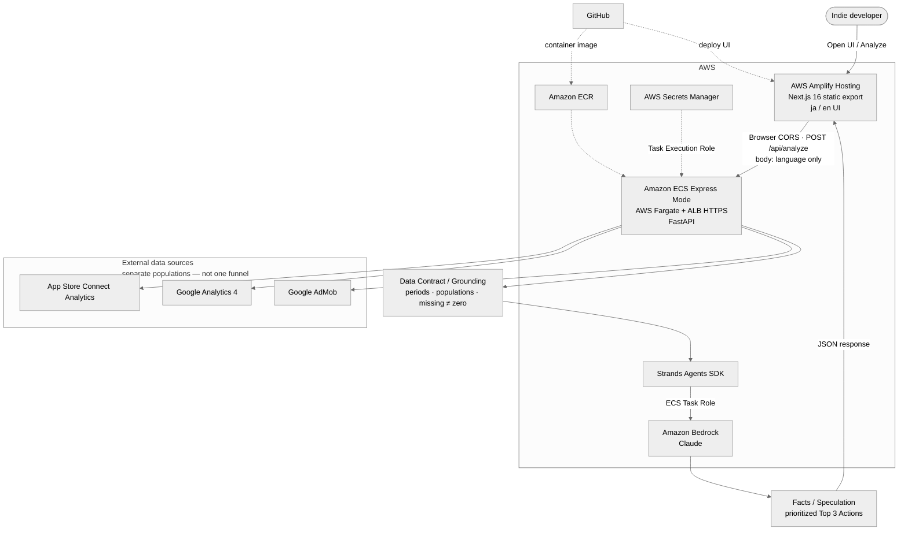

# Architecture — Indie Growth Agent

Hackathon architecture for **Indie Growth Agent**: three observed sources become one grounded priority list.

**Value:** `3 data sources → grounded analysis → 1 priority list`  
Not a multi-dashboard mashup. The agent applies a Data Contract (periods, populations, missing ≠ zero), then returns **Facts / Speculation** and **prioritized Top 3 Actions**.

## Diagram

Source-only Mermaid file: [`architecture.mmd`](architecture.mmd)

## Request flow

1. User opens the Amplify-hosted static Web UI and clicks **Analyze**.
2. Browser calls FastAPI `POST /api/analyze` on the ECS Express Mode HTTPS endpoint (CORS; `{ language }` only).
3. Backend loads secrets via **AWS Secrets Manager** (Task Execution Role) and fetches App Store Connect, GA4, and AdMob.
4. Observed metrics are shaped into a **Data Contract / Grounding** prompt (aligned windows, separate populations, missing ≠ zero).
5. **Strands Agents SDK** invokes **Amazon Bedrock (Claude)** with the ECS **Task Role** (no long-lived AWS access keys in the container).
6. Structured **Facts / Speculation / Top 3 Actions** JSON returns to the browser and renders in the UI.

## Not in this architecture

App Runner, Amplify SSR, Next.js API Route proxy, AgentCore, API Gateway, Cognito, application database, Google Play, RevenueCat, App Store reviews.
